# Advanced Visualization and Marker Analysis

## Overview

Once cells are clustered, the next step is to interpret them. OHMmy
wraps the most common figures into functions that save a
publication-ready file **and** return the ggplot/patchwork object, so
you can keep customising in R.

| Theme | Functions |
|----|----|
| Colours | [`make_cluster_palette()`](https://chomchonu.github.io/OHMmy/reference/make_cluster_palette.md) |
| Embedding overlays | [`PlotDimByFactors()`](https://chomchonu.github.io/OHMmy/reference/PlotDimByFactors.md), [`plot_combined()`](https://chomchonu.github.io/OHMmy/reference/plot_combined.md) |
| Distributions | [`plot_violin_qc_single()`](https://chomchonu.github.io/OHMmy/reference/plot_violin_qc_single.md), [`extract_binned_expression()`](https://chomchonu.github.io/OHMmy/reference/extract_binned_expression.md) |
| Clustered dot plots | [`plot_dot_dendro()`](https://chomchonu.github.io/OHMmy/reference/plot_dot_dendro.md), [`plot_dot_dendro_split()`](https://chomchonu.github.io/OHMmy/reference/plot_dot_dendro_split.md), [`plot_dot_dendro_multi()`](https://chomchonu.github.io/OHMmy/reference/plot_dot_dendro_multi.md), [`cluster_dot_dendro()`](https://chomchonu.github.io/OHMmy/reference/cluster_dot_dendro.md) |
| Co-expression | [`plot_blend_nebulosa()`](https://chomchonu.github.io/OHMmy/reference/plot_blend_nebulosa.md), [`.blend_feature_plot_v5()`](https://chomchonu.github.io/OHMmy/reference/dot-blend_feature_plot_v5.md) |
| Lineage resolution | [`score_consensus()`](https://chomchonu.github.io/OHMmy/reference/score_consensus.md) |

``` r

library(Seurat)
library(OHMmy)
library(patchwork)
library(ggplot2)
source("ohmmy-vignette-helpers.R")

pbmc <- load_pbmc3k_ohmmy()   # built in "Data Processing, Integration, and Clustering"
out_dir <- file.path(tempdir(), "OHMmy-advanced-visualization")
dir.create(out_dir, recursive = TRUE, showWarnings = FALSE)

table(pbmc$cell_type)
#> 
#>       CD4 T       CD8 T          NK           B   CD14 Mono FCGR3A Mono 
#>        1168         298         141         341         478         178 
#>          DC 
#>          34
```

## 1. Colour palettes for many clusters

[`make_cluster_palette()`](https://chomchonu.github.io/OHMmy/reference/make_cluster_palette.md)
returns `n` maximally distinct colours from curated qualitative palettes
(`"kelly"`, `"alphabet"`, `"polychrome"`) or from a blend of
RColorBrewer sets (`"auto"`). When `n` is larger than the palette, it
interpolates.

``` r

pal_df <- do.call(rbind, lapply(c("auto", "kelly", "alphabet", "polychrome"), function(p) {
  data.frame(palette = p, i = 1:16, col = make_cluster_palette(16, palette = p))
}))
ggplot(pal_df, aes(i, palette, fill = col)) +
  geom_tile(colour = "white", linewidth = 0.8) +
  scale_fill_identity() +
  labs(x = NULL, y = NULL) +
  theme_minimal() +
  theme(axis.text.x = element_blank(), panel.grid = element_blank())
```

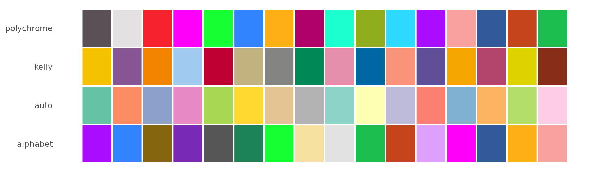

## 2. Embedding overlays

### One UMAP per metadata column

[`PlotDimByFactors()`](https://chomchonu.github.io/OHMmy/reference/PlotDimByFactors.md)
draws one `DimPlot` per metadata column, saves each to disk and returns
the plots as a named list.

``` r

dim_plots <- PlotDimByFactors(
  seurat_obj  = pbmc,
  factors     = c("cell_type", "seurat_clusters", "batch", "Phase"),
  sample_name = "pbmc3k",
  reduction   = "umap.har",
  output_dir  = file.path(out_dir, "dimplots"),
  dpi         = 100,
  verbose     = FALSE
)
```

``` r

names(dim_plots)
#> [1] "cell_type"       "seurat_clusters" "batch"           "Phase"
dim_plots$cell_type <- dim_plots$cell_type +
  scale_colour_manual(values = make_cluster_palette(nlevels(pbmc$cell_type), "kelly"))
wrap_plots(dim_plots, ncol = 2) & NoLegend()
```

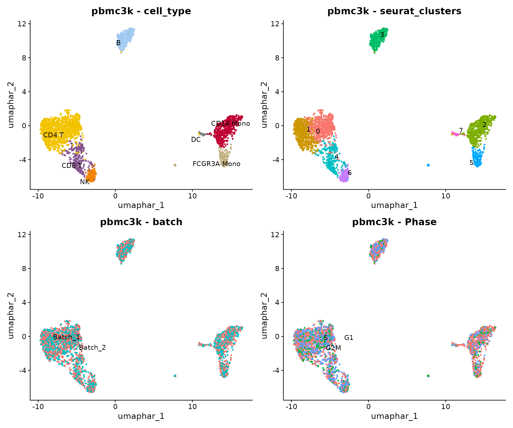

### Feature plots paired with density estimates

Sparse genes are hard to read on a standard `FeaturePlot`.
[`plot_combined()`](https://chomchonu.github.io/OHMmy/reference/plot_combined.md)
places each feature next to its kernel-density estimate (Nebulosa),
using a Seurat v5-safe implementation. Features can be **genes or
numeric metadata columns**, and each list element becomes one saved
figure.

``` r

feature_sets <- list(
  Lymphoid = c("CD3E", "MS4A1", "GNLY"),
  Myeloid  = c("CD14", "FCGR3A", "FCER1A"),
  QC       = c("nCount_RNA", "pct_counts_mt", "percent.ribo")
)

combined <- plot_combined(
  seurat_obj  = pbmc,
  cluster_col = "cell_type",
  genes_list  = feature_sets,
  sample_name = "pbmc3k",
  reduction   = "umap.har",
  output_dir  = file.path(out_dir, "combined"),
  dpi         = 72,
  verbose     = FALSE
)
```

``` r

names(combined$combined_plots)
#> [1] "Lymphoid" "Myeloid"  "QC"
combined$combined_plots$Lymphoid
```

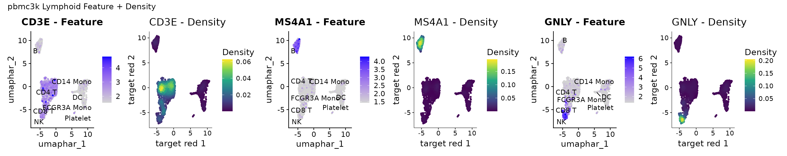

``` r

combined$combined_plots$QC
```

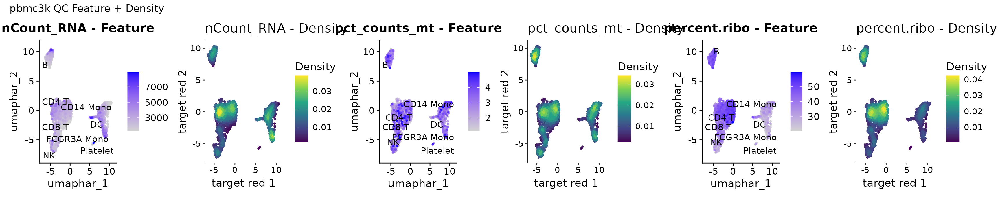

## 3. Distributions across clusters

### Violin plots for QC metrics and genes

[`plot_violin_qc_single()`](https://chomchonu.github.io/OHMmy/reference/plot_violin_qc_single.md)
saves one figure for QC metadata and one for genes, grouped by any
identity column.

``` r

plot_violin_qc_single(
  seurat_obj       = pbmc,
  sample_name      = "pbmc3k",
  qc_meta_features = c("nCount_RNA", "nFeature_RNA", "pct_counts_mt"),
  gene_features    = c("CD3E", "CD8A", "GNLY", "MS4A1", "CD14", "FCGR3A"),
  res_col          = "cell_type",
  output_dir       = file.path(out_dir, "violins"),
  dpi              = 90
)
```

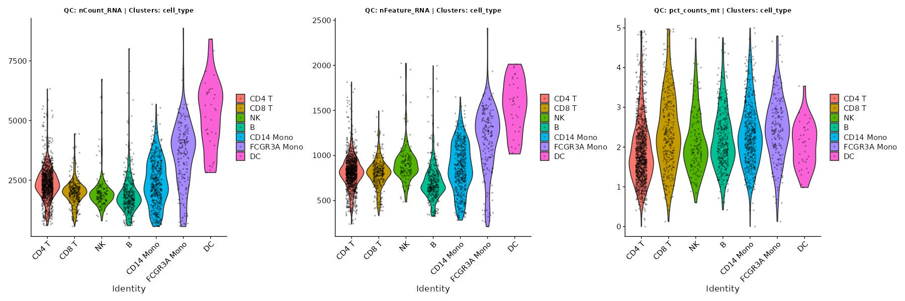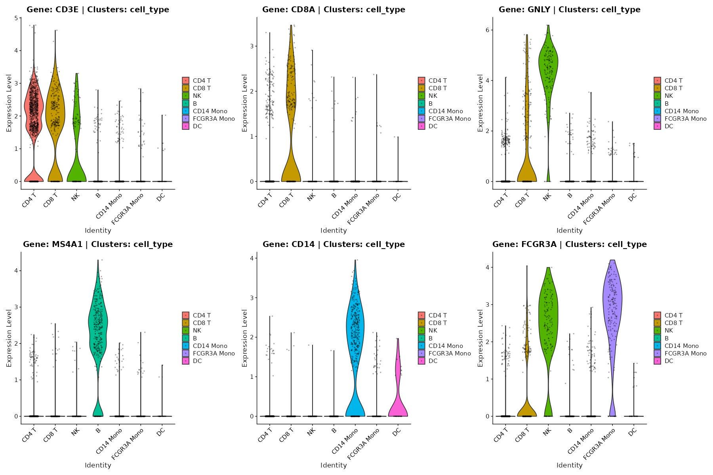

### Discretising expression into Low / Int / High

[`extract_binned_expression()`](https://chomchonu.github.io/OHMmy/reference/extract_binned_expression.md)
returns the average expression and percent expressed per group. For each
gene it then bins the groups into terciles (`Low`, `Int`, `High`). This
is useful for writing marker tables or for defining “marker-high”
populations. The terciles are relative to the groups being compared:
with eight cell types, for example, the three highest-expressing groups
of each gene are labelled `High`.

``` r

binned <- extract_binned_expression(
  seurat_obj = pbmc,
  gene_list  = c("CD3E", "CD8A", "GNLY", "MS4A1", "CD14", "FCGR3A", "FCER1A", "PPBP"),
  group_col  = "cell_type"
)
head(binned)
#> # A tibble: 6 × 5
#>   Cluster Gene   AvgExpression PctExpress Expression_Level
#>   <fct>   <fct>          <dbl>      <dbl> <fct>           
#> 1 CD4 T   CD3E          7.55        77.0  High            
#> 2 CD4 T   CD8A          0.731       11.1  High            
#> 3 CD4 T   GNLY          0.571       10.4  Int             
#> 4 CD4 T   MS4A1         0.203        4.97 Low             
#> 5 CD4 T   CD14          0.0838       1.80 Int             
#> 6 CD4 T   FCGR3A        0.207        4.54 Low
```

``` r

ggplot(binned, aes(Gene, Cluster, fill = Expression_Level)) +
  geom_tile(colour = "white") +
  geom_text(aes(label = round(PctExpress)), size = 3) +
  scale_fill_manual(values = c(Low = "#f0f0f0", Int = "#9ecae1", High = "#08519c")) +
  labs(x = NULL, y = NULL, fill = "Tercile", caption = "Numbers: % of cells expressing") +
  theme_minimal()
```

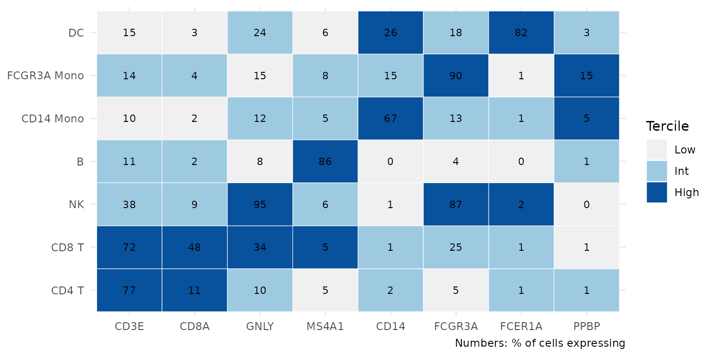

## 4. Hierarchically clustered dot plots

The dot-plot family takes a two-column data frame, `feature_df`, that
maps genes (`feature`) to panels (`group`). Groups are matched by
**prefix**: with `prefix = "PBMC"`, every group starting with `"PBMC_"`
is plotted. This lets one table hold several marker panels, for example
`PBMC_*` and `Tcell_*`.

``` r

feature_df <- data.frame(
  group   = paste0("PBMC_", rep(names(pbmc_marker_sets), lengths(pbmc_marker_sets))),
  feature = unlist(pbmc_marker_sets, use.names = FALSE)
)
head(feature_df, 8)
#>        group feature
#> 1 PBMC_CD4 T    IL7R
#> 2 PBMC_CD4 T    CCR7
#> 3 PBMC_CD4 T    LDHB
#> 4 PBMC_CD4 T    CD3E
#> 5 PBMC_CD4 T     MAL
#> 6 PBMC_CD8 T    CD8A
#> 7 PBMC_CD8 T    CD8B
#> 8 PBMC_CD8 T    CD3D
```

### `plot_dot_dendro()`: genes and clusters clustered together

Genes expressed in fewer than `pct_threshold` % of cells in every group
are dropped. Rows and columns are then ordered by hierarchical
clustering, and both dendrograms are drawn. The function also saves
standalone dendrograms and a text file of the clustered gene order.

``` r

p_dot <- plot_dot_dendro(
  seurat_obj    = pbmc,
  meta_col      = "cell_type",
  feature_df    = feature_df,
  prefix        = "PBMC",
  pct_threshold = 10,
  output_dir    = file.path(out_dir, "dot_dendro")
)
```

``` r

p_dot
```

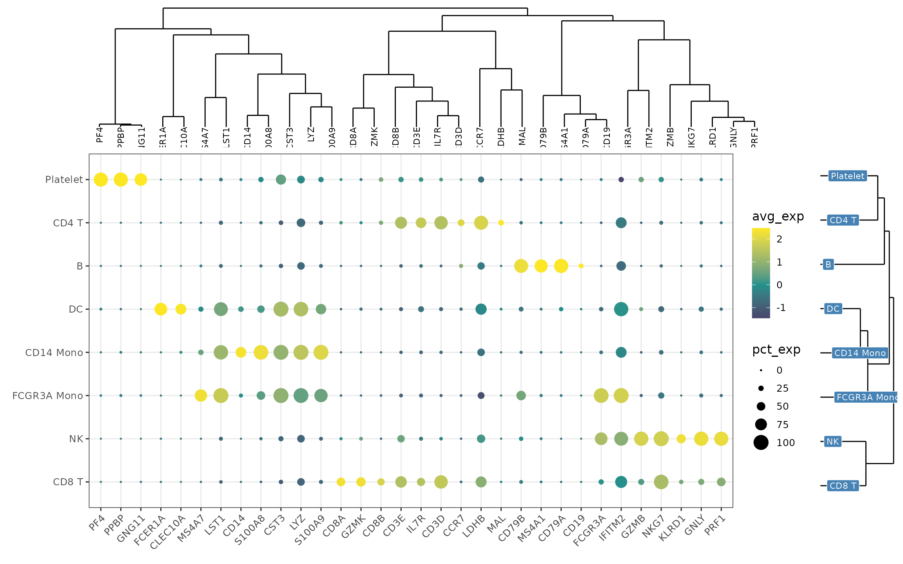

### `plot_dot_dendro_split()`: large panels in chunks

With long marker lists,
[`plot_dot_dendro_split()`](https://chomchonu.github.io/OHMmy/reference/plot_dot_dendro_split.md)
keeps the **global** clustering but splits the gene axis into chunks of
`max_genes_per_plot`. The same cluster dendrogram is attached to every
chunk.

``` r

extended_markers <- list(
  T_cell   = c("CD3D", "CD3E", "CD2", "IL7R", "CCR7", "SELL", "LEF1", "TCF7", "CD8A", "CD8B", "GZMK"),
  NK       = c("GNLY", "NKG7", "KLRD1", "KLRF1", "PRF1", "GZMB", "GZMH", "FCGR3A"),
  B        = c("MS4A1", "CD79A", "CD79B", "BANK1", "TCL1A", "HLA-DQA1"),
  Myeloid  = c("CD14", "LYZ", "S100A8", "S100A9", "VCAN", "MS4A7", "LST1", "CDKN1C", "FCER1A", "CST3"),
  Platelet = c("PPBP", "PF4", "GNG11")
)
feature_df_ext <- data.frame(
  group   = paste0("PBMCext_", rep(names(extended_markers), lengths(extended_markers))),
  feature = unlist(extended_markers, use.names = FALSE)
)

split_plots <- plot_dot_dendro_split(
  seurat_obj         = pbmc,
  meta_col           = "cell_type",
  feature_df         = feature_df_ext,
  prefix             = "PBMCext",
  pct_threshold      = 10,
  max_genes_per_plot = 20,
  output_dir         = file.path(out_dir, "dot_split")
)
```

``` r

length(split_plots)
#> [1] 2
split_plots[[1]]
```

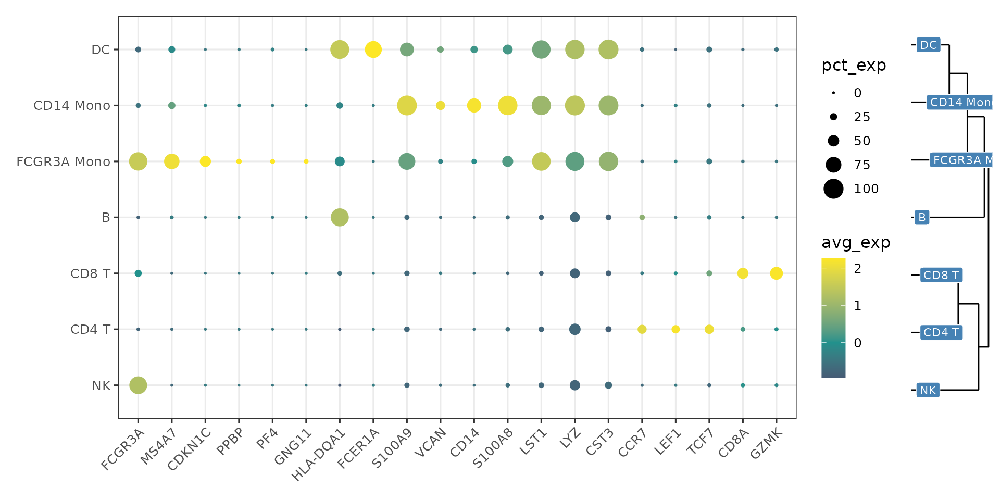

``` r

split_plots[[2]]
```

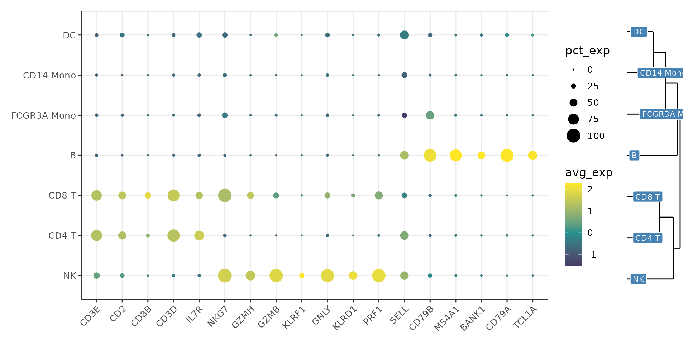

### `plot_dot_dendro_multi()`: several groupings in one clustering

[`plot_dot_dendro_multi()`](https://chomchonu.github.io/OHMmy/reference/plot_dot_dendro_multi.md)
stacks the dot-plot summaries of **several metadata columns** into one
matrix before clustering. Here, plotting the marker-based `cell_type`
labels next to the unsupervised `seurat_clusters` shows directly which
clusters each label absorbed. Rows are named `<group>_<column>`.

``` r

multi_df <- plot_dot_dendro_multi(
  seurat_obj    = pbmc,
  meta_cols     = c("cell_type", "seurat_clusters"),
  feature_df    = feature_df,
  prefix        = "PBMC",
  pct_threshold = 10,
  output_dir    = file.path(out_dir, "dot_multi"),
  save_options  = c("combined", "gene_list")
)
```

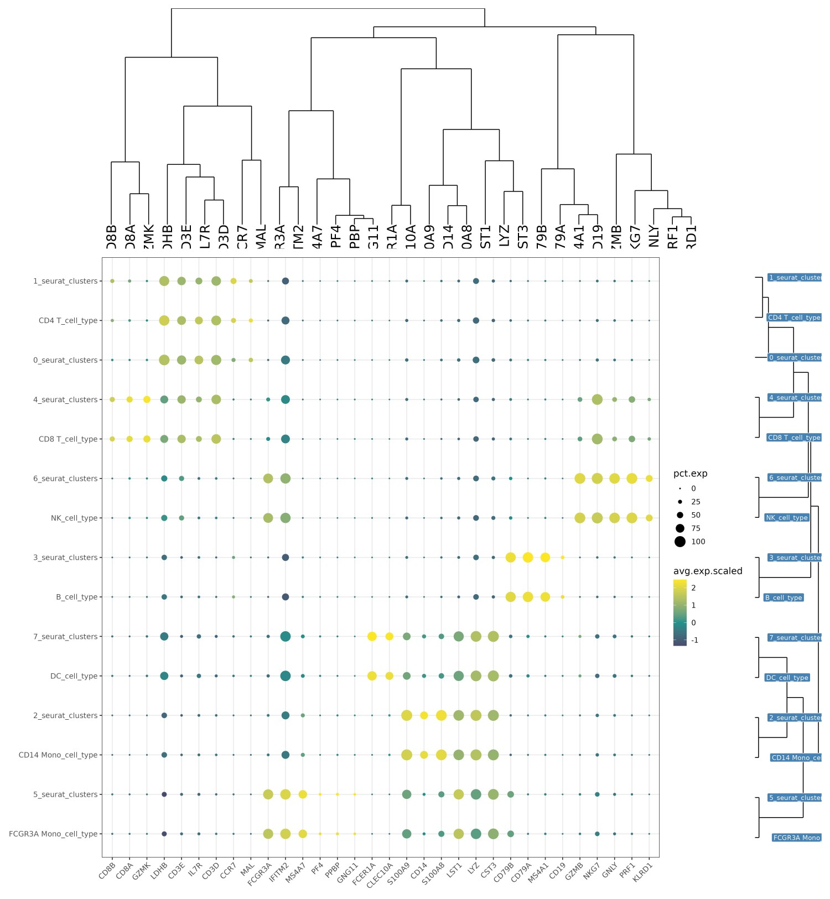

``` r

head(multi_df[, c("cluster_var", "feature", "avg.exp.scaled", "pct.exp")])
#>              cluster_var feature avg.exp.scaled  pct.exp
#> IL7R...1 CD4 T_cell_type    IL7R      1.6004838 66.43836
#> CCR7...2 CD4 T_cell_type    CCR7      1.9228209 36.38699
#> LDHB...3 CD4 T_cell_type    LDHB      1.7808176 92.72260
#> CD3E...4 CD4 T_cell_type    CD3E      1.3155181 76.96918
#> MAL...5  CD4 T_cell_type     MAL      2.2501354 27.31164
#> CD8A...6 CD4 T_cell_type    CD8A      0.2059775 11.13014
```

### Cutting the dendrograms into clusters with `cluster_dot_dendro()`

[`cluster_dot_dendro()`](https://chomchonu.github.io/OHMmy/reference/cluster_dot_dendro.md)
takes the output of
[`plot_dot_dendro_multi()`](https://chomchonu.github.io/OHMmy/reference/plot_dot_dendro_multi.md)
and cuts its dendrograms into clusters of groups, of genes, or both. It
uses the exact trees behind the figure, which are attached to the
returned data frame.

Natural clusters often sit at different heights of a dendrogram, so a
single horizontal cut either merges tight clusters or splits loose ones.
The default `"inconsistency"` method therefore cuts each branch at its
own height: a branch stays one cluster while none of its merges is
unusually high compared with the merges directly below it. The threshold
is chosen automatically by silhouette width, and every candidate is
reported.

``` r

dc <- cluster_dot_dendro(multi_df, what = "both")

dc$k
#>  rows genes 
#>     7    10
dc$selection$rows
#>      cutoff n_clusters n_unassigned avg_silhouette selected
#> 1 0.0000000          7            1      0.8198003    FALSE
#> 2 0.6194836          7            1      0.8198003    FALSE
#> 3 0.7071068          7            0      0.8541494     TRUE
#> 4 0.8424165          7            0      0.8541494    FALSE
#> 5 0.9006495          7            0      0.8541494    FALSE
#> 6 1.0008067          7            0      0.8541494    FALSE
#> 7 1.1160426          7            0      0.8541494    FALSE
#> 8 1.1546760          1            0             NA    FALSE
#> 9 2.1546760          1            0             NA    FALSE
head(dc$clusters[dc$clusters$type == "rows",
                 c("label", "cluster", "cluster_height", "cut_height")], 10)
#>                    label cluster cluster_height cut_height
#> 1  FCGR3A Mono_cell_type      C1      0.6418832   4.208865
#> 2      5_seurat_clusters      C1      0.6418832   4.208865
#> 3    CD14 Mono_cell_type      C2      0.5690872   2.863924
#> 4      2_seurat_clusters      C2      0.5690872   2.863924
#> 5           DC_cell_type      C3      0.6035432   2.881152
#> 6      7_seurat_clusters      C3      0.6035432   2.881152
#> 7            B_cell_type      C4      0.6514424   4.826426
#> 8      3_seurat_clusters      C4      0.6514424   4.826426
#> 9           NK_cell_type      C5      0.6249326   4.612283
#> 10     6_seurat_clusters      C5      0.6249326   4.612283
```

Each cluster gets its own cut height, marked by a dashed line. Leaves
that do not clearly belong to any cluster stay unassigned (grey); use
`assign_all = TRUE` to assign them to their nearest cluster.

``` r

dc$plot$rows
```

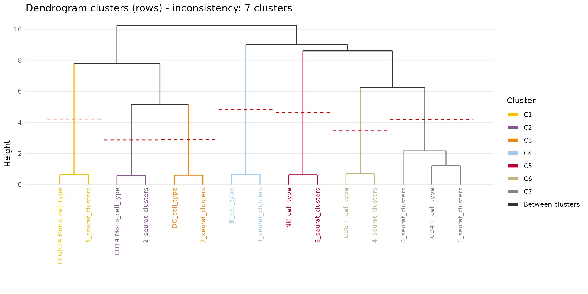

The same call also returns gene modules: genes whose scaled expression
varies together across the groups.

``` r

split(dc$clusters$label[dc$clusters$type == "genes"],
      dc$clusters$cluster[dc$clusters$type == "genes"])
#> $C1
#> [1] "CD8B" "CD8A" "GZMK"
#> 
#> $C2
#> [1] "LDHB" "CD3E" "IL7R" "CD3D"
#> 
#> $C3
#> [1] "CCR7" "MAL" 
#> 
#> $C4
#> [1] "FCGR3A" "IFITM2"
#> 
#> $C5
#> [1] "MS4A7" "PF4"   "PPBP"  "GNG11"
#> 
#> $C6
#> [1] "FCER1A"  "CLEC10A"
#> 
#> $C7
#> [1] "S100A9" "CD14"   "S100A8"
#> 
#> $C8
#> [1] "LST1" "LYZ"  "CST3"
#> 
#> $C9
#> [1] "CD79B" "CD79A" "MS4A1" "CD19" 
#> 
#> $C10
#> [1] "GZMB"  "NKG7"  "GNLY"  "PRF1"  "KLRD1"
dc$plot$genes
```

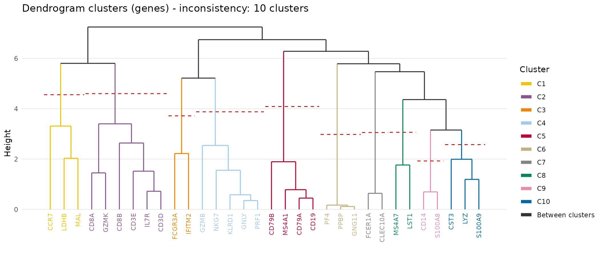

For comparison, `method = "dynamic"` uses the hybrid dynamic tree cut of
the **dynamicTreeCut** package, and `method = "fixed"` an ordinary cut
by `k` or `h`.

``` r

c(inconsistency = unname(dc$k["rows"]),
  dynamic       = unname(cluster_dot_dendro(multi_df, method = "dynamic")$k["rows"]),
  fixed_k4      = unname(cluster_dot_dendro(multi_df, method = "fixed", k = 4)$k["rows"]))
#> inconsistency       dynamic      fixed_k4 
#>             7             7             4
```

Finally, the group clusters can be written back to the cells. Here each
`seurat_clusters` cluster receives the dendrogram cluster of its row,
giving a coarser grouping of the clusters based on their marker
profiles:

``` r

dc_cells <- cluster_dot_dendro(multi_df, seurat_obj = pbmc, meta_col = "seurat_clusters",
                               new_col = "marker_group")
table(seurat_cluster = pbmc$seurat_clusters, marker_group = dc_cells$seurat_obj$marker_group,
      useNA = "ifany")
#>               marker_group
#> seurat_cluster  C1  C2  C3  C4  C5  C6  C7
#>              0   0   0   0   0   0   0 614
#>              1   0   0   0   0   0   0 554
#>              2   0 478   0   0   0   0   0
#>              3   0   0   0 341   0   0   0
#>              4   0   0   0   0   0 298   0
#>              5 178   0   0   0   0   0   0
#>              6   0   0   0   0 141   0   0
#>              7   0   0  34   0   0   0   0
DimPlot(dc_cells$seurat_obj, reduction = "umap.har", group.by = "marker_group", label = TRUE) +
  DimPlot(pbmc, reduction = "umap.har", group.by = "cell_type", label = TRUE, repel = TRUE) & NoLegend()
```

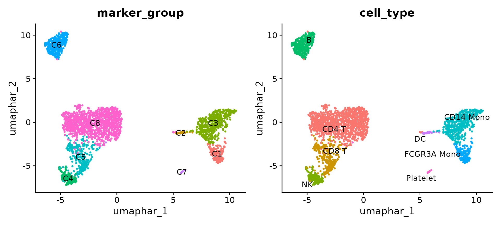

## 5. Co-expression: blend and density plots

[`plot_blend_nebulosa()`](https://chomchonu.github.io/OHMmy/reference/plot_blend_nebulosa.md)
produces one row per gene pair with the two single-gene panels, their
colour blend, a 2-D colour key, and a Nebulosa density estimate for each
gene. Cells below `blend_threshold` (after scaling to 0 to 1) are shown
as background, which keeps sparse genes readable. All pairs are stacked
into one saved figure.

``` r

blend <- plot_blend_nebulosa(
  seurat_obj      = pbmc,
  cluster_col     = "cell_type",
  gene_pairs      = list(c("CD3E", "GNLY"), c("CD14", "FCGR3A")),
  sample_name     = "pbmc3k",
  reduction       = "umap.har",
  blend_threshold = 0.1,
  width           = 24,
  dpi             = 72,
  output_dir      = file.path(out_dir, "blend"),
  verbose         = FALSE
)
```

``` r

blend$dimensions
#> $width
#> [1] 24
#> 
#> $height
#> [1] 7.2
blend$plot
```

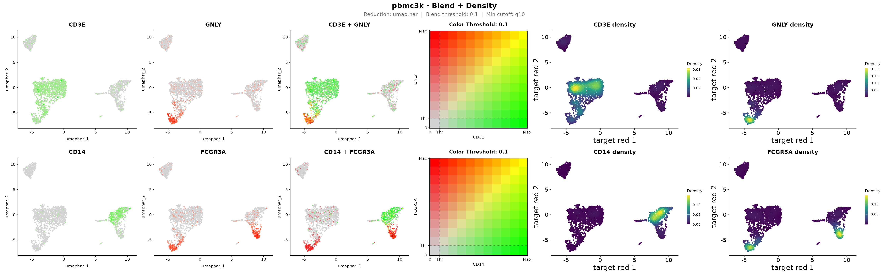

The *CD3E*/*GNLY* row separates T cells (green), NK cells (red) and the
cytotoxic CD8 T cells that express both (yellow). The *CD14*/*FCGR3A*
row shows the two monocyte subsets and the intermediate cells between
them.

The four-panel blend is also available on its own as
[`.blend_feature_plot_v5()`](https://chomchonu.github.io/OHMmy/reference/dot-blend_feature_plot_v5.md),
a Seurat v5-compatible replacement for `FeaturePlot(blend = TRUE)`.

``` r

.blend_feature_plot_v5(
  pbmc, gene1 = "CD8A", gene2 = "GZMK", reduction = "umap.har",
  cols = c("lightgrey", "#1b9e77", "#d95f02"), blend_threshold = 0.15, pt_size = 0.6
)
```

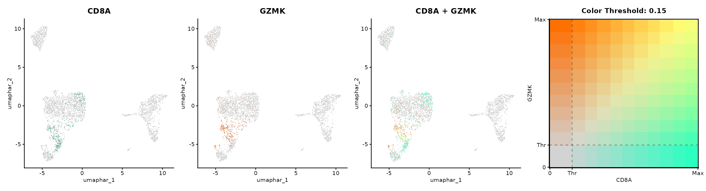

## 6. Resolving CD8 T cells from NK cells with `score_consensus()`

Cytotoxic CD8 T cells and NK cells share much of their effector
programme and are often mixed in clustering.
[`score_consensus()`](https://chomchonu.github.io/OHMmy/reference/score_consensus.md)
compares one or more **CD8 signature scores** with an **NK signature
score** for each cell. It labels a cell CD8 when `z(CD8) - z(NK)`
exceeds a cutoff, which can be fixed (`"fixed"`), the density valley
(`"trough"`), or the decision boundary of a two-component Gaussian
mixture (`"gmm"`). Two CD8 signatures act as `primary` and `confirm`
scores, and disagreements are flagged as ambiguous. Bootstrapping
reports how stable the cutoff is.

Any per-cell score can be used, such as
[`AddModuleScore()`](https://satijalab.org/seurat/reference/AddModuleScore.html)
or UCell. Here we score the CD8 T and NK cells with
[`AddModuleScore()`](https://satijalab.org/seurat/reference/AddModuleScore.html).

``` r

cyto <- subset(pbmc, subset = cell_type %in% c("CD8 T", "NK"))

score_sets <- list(
  CD8_core = c("CD8A", "CD8B"),
  CD8_TCR  = c("CD3D", "CD3E", "CD3G", "CD8A", "CD8B", "LCK"),
  NK_score = c("GNLY", "KLRD1", "KLRF1", "FCGR3A", "NCAM1", "TYROBP", "FCER1G")
)
for (s in names(score_sets)) {
  cyto <- AddModuleScore(cyto, features = list(score_sets[[s]]), name = s, seed = 1)
  names(cyto@meta.data)[names(cyto@meta.data) == paste0(s, "1")] <- s
}
```

With `method = "gmm"`, the cutoff is the decision boundary of a
two-component Gaussian mixture fitted with **mclust**, which only needs
to be installed. If no cutoff can be estimated, `fixed_cut` is used
instead, and the `fallback` column of `cons$cutoffs` reports this.

``` r

cons <- score_consensus(
  obj         = cyto,
  cd8_cols    = c("CD8_TCR", "CD8_core"),
  nk_col      = "NK_score",
  method      = "gmm",
  n_boot      = 100,
  boot_target = "cutoff",
  make_plots  = TRUE,
  plot_n      = 300,
  out_dir     = file.path(out_dir, "cd8_vs_nk")
)

cons$cutoffs
#>    variant     cutoff fallback   med_diff q05_diff q95_diff  frac_cd8
#> 1  CD8_TCR -0.8432246    FALSE 0.60889522 -2.88979 2.367464 0.6514806
#> 2 CD8_core -1.2859800    FALSE 0.07507069 -2.44122 2.751788 0.6924829
cons$agreement
#>            CD8_TCR  CD8_core
#> CD8_TCR  1.0000000 0.9453303
#> CD8_core 0.9453303 1.0000000
cons$bootstrap$summary
#>    variant target   observed       mean        sd     ci_lo      ci_hi fb_rate
#> 1  CD8_TCR cutoff -0.8432246 -0.7863805 0.1892429 -1.111310 -0.4723863       0
#> 2 CD8_core cutoff -1.2859800 -1.2765134 0.1086915 -1.497219 -1.0857047       0
```

Both variants get a data-driven cutoff (`fallback = FALSE`), and the
bootstrap confidence intervals show how stable it is. The consensus
agrees with the cluster-level annotation for the large majority of
cells. Most of the remaining cells are flagged as *Ambiguous*, because
the primary and confirmatory CD8 signatures disagree on them. These
cells are good candidates for closer inspection:

``` r

table(consensus = cons$consensus, annotation = cyto$cell_type)
#>                        annotation
#> consensus               CD4 T CD8 T  NK   B CD14 Mono FCGR3A Mono  DC
#>   Ambiguous_CD8_confirm     0     7  14   0         0           0   0
#>   Ambiguous_CD8_primary     0     2   1   0         0           0   0
#>   CD8                       0   274   9   0         0           0   0
#>   NK                        0    15 117   0         0           0   0
```

``` r

(cons$plots$Violin_CD8_TCR) /
  (cons$plots$Primary_vs_Confirm | cons$plots$Bootstrap_ForestPlot)
```

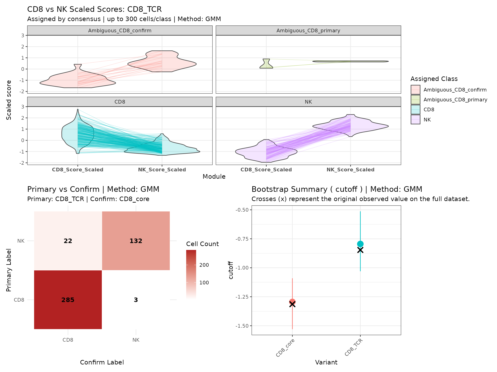

The labels are also written to the object’s metadata (prefix `CD8vNK_`),
ready for plotting:

``` r

grep("^CD8vNK_", colnames(cons$obj@meta.data), value = TRUE)
#> [1] "CD8vNK_diff_CD8_TCR"      "CD8vNK_label_CD8_TCR"    
#> [3] "CD8vNK_cd8scale_CD8_TCR"  "CD8vNK_diff_CD8_core"    
#> [5] "CD8vNK_label_CD8_core"    "CD8vNK_cd8scale_CD8_core"
#> [7] "CD8vNK_nkscale"           "CD8vNK_consensus"
DimPlot(cons$obj, reduction = "umap.har", group.by = "CD8vNK_consensus") +
  FeaturePlot(cons$obj, reduction = "umap.har", features = "CD8vNK_diff_CD8_TCR") +
  scale_colour_gradient2(low = "#b2182b", mid = "grey90", high = "#2166ac")
```

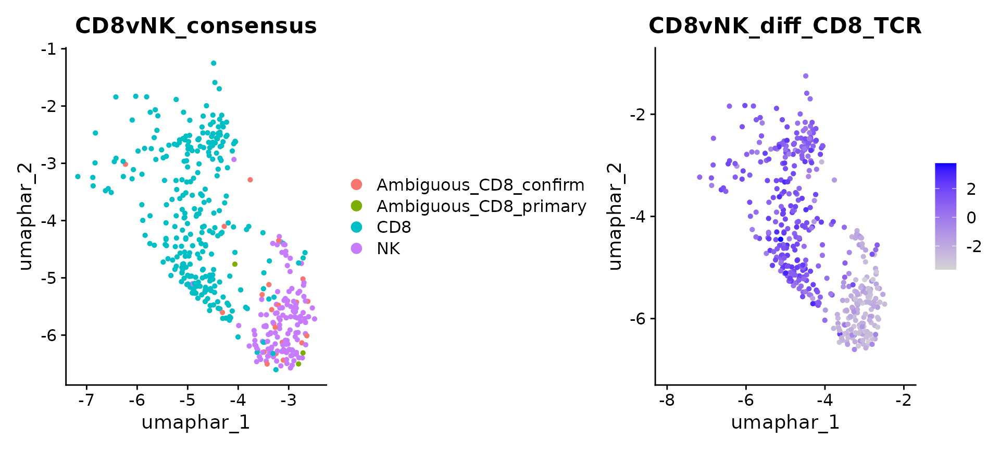

## Session information

``` r

sessionInfo()
#> R version 4.6.1 (2026-06-24)
#> Platform: x86_64-pc-linux-gnu
#> Running under: Ubuntu 22.04.5 LTS
#> 
#> Matrix products: default
#> BLAS:   /usr/lib/x86_64-linux-gnu/openblas-pthread/libblas.so.3 
#> LAPACK: /usr/lib/x86_64-linux-gnu/openblas-pthread/libopenblasp-r0.3.20.so;  LAPACK version 3.10.0
#> 
#> locale:
#>  [1] LC_CTYPE=C.UTF-8       LC_NUMERIC=C           LC_TIME=C.UTF-8       
#>  [4] LC_COLLATE=C.UTF-8     LC_MONETARY=C.UTF-8    LC_MESSAGES=C.UTF-8   
#>  [7] LC_PAPER=C.UTF-8       LC_NAME=C              LC_ADDRESS=C          
#> [10] LC_TELEPHONE=C         LC_MEASUREMENT=C.UTF-8 LC_IDENTIFICATION=C   
#> 
#> time zone: UTC
#> tzcode source: system (glibc)
#> 
#> attached base packages:
#> [1] stats     graphics  grDevices utils     datasets  methods   base     
#> 
#> other attached packages:
#> [1] ggraph_2.2.2       ggplot2_4.0.3      patchwork_1.3.2    OHMmy_1.0.2.9000  
#> [5] Seurat_5.6.0       SeuratObject_5.4.0 sp_2.2-4          
#> 
#> loaded via a namespace (and not attached):
#>   [1] RcppAnnoy_0.0.23            splines_4.6.1              
#>   [3] later_1.4.8                 tibble_3.3.1               
#>   [5] R.oo_1.27.1                 polyclip_1.10-7            
#>   [7] fastDummies_1.7.6           lifecycle_1.0.5            
#>   [9] rstatix_1.1.0               globals_0.20.0             
#>  [11] lattice_0.22-9              MASS_7.3-65                
#>  [13] backports_1.5.1             magrittr_2.0.5             
#>  [15] plotly_4.12.1               sass_0.4.10                
#>  [17] rmarkdown_2.32              jquerylib_0.1.4            
#>  [19] yaml_2.3.12                 httpuv_1.6.17              
#>  [21] otel_0.2.0                  sctransform_0.4.3          
#>  [23] spam_2.11-4                 spatstat.sparse_3.2-0      
#>  [25] reticulate_1.47.0           cowplot_1.2.0              
#>  [27] pbapply_1.7-5               RColorBrewer_1.1-3         
#>  [29] abind_1.4-8                 GenomicRanges_1.64.0       
#>  [31] Rtsne_0.17                  purrr_1.2.2                
#>  [33] R.utils_2.13.0              BiocGenerics_0.58.1        
#>  [35] pracma_2.4.6                tweenr_2.0.3               
#>  [37] IRanges_2.46.0              S4Vectors_0.50.3           
#>  [39] ggrepel_0.9.8               irlba_2.4.1                
#>  [41] listenv_1.1.0               spatstat.utils_3.2-5       
#>  [43] goftest_1.2-3               RSpectra_0.16-2            
#>  [45] spatstat.random_3.5-2       fitdistrplus_1.2-6         
#>  [47] parallelly_1.48.0           pkgdown_2.2.1              
#>  [49] DelayedArray_0.38.2         codetools_0.2-20           
#>  [51] ggforce_0.5.0               tidyselect_1.2.1           
#>  [53] farver_2.1.2                SoupX_1.6.2                
#>  [55] viridis_0.6.5               dynamicTreeCut_1.63-1      
#>  [57] matrixStats_1.5.0           stats4_4.6.1               
#>  [59] spatstat.explore_3.8-3      Seqinfo_1.2.0              
#>  [61] jsonlite_2.0.0              ks_1.15.3                  
#>  [63] tidygraph_1.3.1             progressr_1.0.0            
#>  [65] Formula_1.2-6               ggridges_0.5.7             
#>  [67] survival_3.8-6              systemfonts_1.3.2          
#>  [69] tools_4.6.1                 ragg_1.5.2                 
#>  [71] ica_1.0-3                   Rcpp_1.1.2                 
#>  [73] glue_1.8.1                  SparseArray_1.12.3         
#>  [75] gridExtra_2.3.1             xfun_0.61                  
#>  [77] MatrixGenerics_1.24.0       dplyr_1.2.1                
#>  [79] withr_3.0.3                 fastmap_1.2.0              
#>  [81] clustree_0.5.1              digest_0.6.39              
#>  [83] R6_2.6.1                    mime_0.13                  
#>  [85] textshaping_1.0.5           Cairo_1.7-0                
#>  [87] scattermore_1.2             tensor_1.5.1               
#>  [89] jpeg_0.1-11                 spatstat.data_3.1-9        
#>  [91] R.methodsS3_1.8.2           RhpcBLASctl_0.23-42        
#>  [93] utf8_1.2.6                  Nebulosa_1.22.0            
#>  [95] tidyr_1.3.2                 generics_0.1.4             
#>  [97] data.table_1.18.6.1         S4Arrays_1.12.1            
#>  [99] graphlayouts_1.2.5          httr_1.4.9                 
#> [101] htmlwidgets_1.6.4           uwot_0.2.5                 
#> [103] pkgconfig_2.0.3             gtable_0.3.6               
#> [105] lmtest_0.9-40               S7_0.2.2                   
#> [107] XVector_0.52.0              SingleCellExperiment_1.34.0
#> [109] htmltools_0.5.9             carData_3.0-6              
#> [111] dotCall64_1.2               Biobase_2.72.0             
#> [113] scales_1.4.0                png_0.1-9                  
#> [115] harmony_2.0.5               spatstat.univar_3.2-0      
#> [117] ggdendro_0.2.0              knitr_1.52                 
#> [119] reshape2_1.4.5              checkmate_2.3.4            
#> [121] nlme_3.1-169                cachem_1.1.0               
#> [123] zoo_1.9-1                   stringr_1.6.0              
#> [125] KernSmooth_2.23-26          vipor_0.4.7                
#> [127] parallel_4.6.1              miniUI_0.1.2               
#> [129] ggrastr_1.0.2               desc_1.4.3                 
#> [131] pillar_1.11.1               grid_4.6.1                 
#> [133] vctrs_0.7.3                 RANN_2.6.3                 
#> [135] promises_1.5.0              ggpubr_1.0.0               
#> [137] car_3.1-5                   xtable_1.8-8               
#> [139] cluster_2.1.8.2             beeswarm_0.4.0             
#> [141] evaluate_1.0.5              mvtnorm_1.4-2              
#> [143] cli_3.6.6                   compiler_4.6.1             
#> [145] rlang_1.3.0                 leidenbase_0.1.37          
#> [147] future.apply_1.20.2         ggsignif_0.6.4             
#> [149] labeling_0.4.3              mclust_6.1.3               
#> [151] ggbeeswarm_0.7.3            plyr_1.8.9                 
#> [153] fs_2.1.0                    stringi_1.8.9              
#> [155] viridisLite_0.4.3           deldir_2.0-4               
#> [157] spatstat.geom_3.8-3         Matrix_1.7-5               
#> [159] RcppHNSW_0.7.0              future_1.76.0              
#> [161] shiny_1.14.0                SummarizedExperiment_1.42.0
#> [163] ROCR_1.0-12                 igraph_2.3.4               
#> [165] broom_1.0.13                memoise_2.0.1              
#> [167] bslib_0.12.0
```
