# Differential Expression and Pathway Enrichment

## Overview

This article goes from cluster markers to pathways and pseudo-bulk
differential expression.

| Step | Functions |
|----|----|
| Cluster markers | [`FindTopMarkersAndHeatmap()`](https://chomchonu.github.io/OHMmy/reference/FindTopMarkersAndHeatmap.md) |
| Markers across resolutions, dichotomous key | [`find_hierarchical_markers()`](https://chomchonu.github.io/OHMmy/reference/find_hierarchical_markers.md) |
| Marker tables across conditions | [`plot_gene_markers_with_dendro()`](https://chomchonu.github.io/OHMmy/reference/plot_gene_markers_with_dendro.md), [`plot_split_dotplots_by_gene_cluster()`](https://chomchonu.github.io/OHMmy/reference/plot_split_dotplots_by_gene_cluster.md) |
| Pathway enrichment | [`run_global_gsea()`](https://chomchonu.github.io/OHMmy/reference/run_global_gsea.md), [`run_global_ora()`](https://chomchonu.github.io/OHMmy/reference/run_global_ora.md) |
| Pseudo-bulk DESeq2 visualisation | [`generate_volcano_trio()`](https://chomchonu.github.io/OHMmy/reference/generate_volcano_trio.md), [`get_top_mixed_genes()`](https://chomchonu.github.io/OHMmy/reference/get_top_mixed_genes.md), [`generate_and_save_heatmap()`](https://chomchonu.github.io/OHMmy/reference/generate_and_save_heatmap.md) |

``` r

library(Seurat)
library(OHMmy)
library(dplyr)
library(ggplot2)
source("ohmmy-vignette-helpers.R")

library(msigdbr)   # MSigDB gene sets
library(DESeq2)    # pseudo-bulk differential expression

pbmc <- load_pbmc3k_ohmmy()   # built in "Data Processing, Integration, and Clustering"
out_dir <- file.path(tempdir(), "OHMmy-differential-expression")
dir.create(out_dir, recursive = TRUE, showWarnings = FALSE)
```

The classic GSEA enrichment plots and the volcano plots additionally use
the suggested packages **enrichplot** and **EnhancedVolcano**. OHMmy
calls them internally, so they only need to be installed.

## 1. Cluster markers with `FindTopMarkersAndHeatmap()`

[`FindTopMarkersAndHeatmap()`](https://chomchonu.github.io/OHMmy/reference/FindTopMarkersAndHeatmap.md)
runs
[`FindAllMarkers()`](https://satijalab.org/seurat/reference/FindAllMarkers.html)
on the active identities, or
[`FindMarkers()`](https://satijalab.org/seurat/reference/FindMarkers.html)
for a single pairwise comparison when `compare` is given. It uses
`logfc.threshold = 0` and `min.pct = 0`, so the complete ranked table
needed for GSEA is kept. Markers are then ranked by a combined relevance
score, `|log2FC| x |pct.1 - pct.2| / p_adj`, filtered by the three
`marker_*` thresholds, and the top `top_n` per cluster are drawn in a
`DoHeatmap`. Three CSV files are written: all markers, a GSEA/ORA-ready
copy, and the filtered top markers.

``` r

Idents(pbmc) <- "cell_type"

mk <- FindTopMarkersAndHeatmap(
  seurat_obj      = pbmc,
  sample_name     = "pbmc3k_celltype",
  top_n           = 6,
  onlyPos         = TRUE,
  output_dir_base = file.path(out_dir, "markers"),
  height          = 11,
  dpi             = 100
)
```

``` r

names(mk)
#> [1] "top_markers" "heatmap"     "markers"     "output_dir"
mk$top_markers %>%
  group_by(cluster) %>%
  slice_head(n = 3) %>%
  dplyr::select(cluster, gene, avg_log2FC, pct.1, pct.2, p_val_adj, score)
#> # A tibble: 21 × 7
#> # Groups:   cluster [7]
#>    cluster gene   avg_log2FC pct.1 pct.2 p_val_adj        score
#>    <fct>   <chr>       <dbl> <dbl> <dbl>     <dbl>        <dbl>
#>  1 CD4 T   CD3D         1.84 0.875 0.238         0 11707548842.
#>  2 CD4 T   MAL          4.22 0.273 0.023         0 10544703625.
#>  3 CD4 T   IL7R         2.14 0.664 0.195         0 10059451479.
#>  4 CD8 T   GZMK         4.57 0.587 0.053         0 24411707948.
#>  5 CD8 T   CCL5         3.25 0.953 0.235         0 23328815222.
#>  6 CD8 T   NKG7         2.55 0.973 0.213         0 19406875071.
#>  7 NK      GZMB         5.89 0.972 0.072         0 52972497610.
#>  8 NK      FGFBP2       5.40 0.922 0.064         0 46355989739.
#>  9 NK      PRF1         5.11 0.972 0.11          0 44009493902.
#> 10 B       CD79A        6.85 0.938 0.042         0 61335103114.
#> # ℹ 11 more rows
mk$heatmap
```


### Pairwise comparison

With `compare = c(ident.1, ident.2)`, the function runs a single
[`FindMarkers()`](https://satijalab.org/seurat/reference/FindMarkers.html)
test. It adds the `gene` and `cluster` columns (each gene is assigned to
the identity in which it is higher), so the output has the same format
as the all-cluster version. With `onlyPos = FALSE`, genes enriched on
both sides are kept.

``` r

mk_mono <- FindTopMarkersAndHeatmap(
  seurat_obj      = subset(pbmc, subset = cell_type %in% c("CD14 Mono", "FCGR3A Mono")),
  sample_name     = "pbmc3k_monocytes",
  compare         = c("FCGR3A Mono", "CD14 Mono"),
  onlyPos         = FALSE,
  top_n           = 10,
  output_dir_base = file.path(out_dir, "markers"),
  height          = 7,
  dpi             = 100
)
```

``` r

table(mk_mono$top_markers$cluster)
#> 
#>   CD14 Mono FCGR3A Mono 
#>          10          10
mk_mono$heatmap
```


### Markers across resolutions: a dichotomous key

Low resolutions separate the major populations and higher resolutions
split them into sub-populations.
[`find_hierarchical_markers()`](https://chomchonu.github.io/OHMmy/reference/find_hierarchical_markers.md)
follows the clusters from low to high resolution. It links each cluster
to the lower-resolution cluster that holds most of its cells, and that
share is reported as `purity`. At every split it compares each child
**with its siblings only**, so broad markers shared by all children (for
example *CD3E* within T cells) do not reappear at the finer levels.

Markers must pass four filters: adjusted p-value, log2FC, `pct.1` and
`pct.1 - pct.2`. They are then ranked by **AUC**, the probability that a
random child cell expresses the gene more highly than a random sibling
cell (0.5 = no separation, 1 = perfect). The clusters were defined on
the same data, so the p-values are optimistic. They work as a filter,
not as evidence on their own.

``` r

hm <- find_hierarchical_markers(
  seurat_obj  = pbmc,
  res_cols    = c("har_snn_res.0.2", "har_snn_res.0.6", "har_snn_res.1.2"),
  sample_name = "pbmc3k",
  output_dir  = file.path(out_dir, "hierarchical_markers")
)
```

`hm$splits` summarises each split. `hm$markers` holds every gene that
passed the filters, with its rank, AUC, the usual DE statistics and a
`pattern`:

| Pattern | Meaning |
|----|----|
| `lineage` | Marks this child, but does not separate its own sub-clusters (shared by all of them) |
| `split` | Separates this child from its siblings |
| `specific` | The child does not split further, and the gene also separates it from all other cells (`auc_vs_all >= 0.8`) |
| `unstable` | The child has purity below `min_purity`: its cells came from more than one parent, so the split is not clean across resolutions |

``` r

hm$splits[, c("split", "children", "n_markers", "n_key_genes", "cv_accuracy")]
#>      split                               children n_markers n_key_genes
#> 1     root res0.2_0, res0.2_1, res0.2_2, res0.2_3       142           3
#> 2 res0.2_0                     res0.6_0, res0.6_1         5           1
#> 3 res0.2_1           res0.6_2, res0.6_5, res0.6_7        86           5
#> 4 res0.2_2                     res0.6_4, res0.6_6        34           3
#> 5 res0.6_0                    res1.2_0, res1.2_10        14           2
#> 6 res0.6_1                     res1.2_1, res1.2_8         1           0
#> 7 res0.6_2                     res1.2_4, res1.2_5        30           1
#> 8 res0.6_5                    res1.2_6, res1.2_11         0           0
#>   cv_accuracy
#> 1   0.9624716
#> 2   0.6907216
#> 3   0.9144928
#> 4   0.9402299
#> 5   0.9580537
#> 6   1.0000000
#> 7   0.7088608
#> 8          NA
hm$markers %>%
  group_by(split, child) %>%
  slice_head(n = 2) %>%
  dplyr::select(split, child, gene, rank, auc, p_val_adj, pct.1, pct.2, pattern)
#> # A tibble: 25 × 9
#> # Groups:   split, child [13]
#>    split    child    gene      rank   auc p_val_adj pct.1 pct.2 pattern 
#>    <chr>    <chr>    <chr>    <int> <dbl>     <dbl> <dbl> <dbl> <chr>   
#>  1 res0.2_0 res0.6_0 ANXA1        1 0.718         0 0.79  0.423 lineage 
#>  2 res0.2_0 res0.6_0 S100A11      2 0.702         0 0.61  0.22  lineage 
#>  3 res0.2_1 res0.6_2 S100A8       1 0.951         0 0.973 0.467 lineage 
#>  4 res0.2_1 res0.6_2 LGALS2       2 0.879         0 0.904 0.349 lineage 
#>  5 res0.2_1 res0.6_5 FCGR3A       1 0.936         0 0.904 0.129 lineage 
#>  6 res0.2_1 res0.6_5 RHOC         2 0.854         0 0.809 0.178 lineage 
#>  7 res0.2_1 res0.6_7 HLA-DQA1     1 0.937         0 0.941 0.27  specific
#>  8 res0.2_1 res0.6_7 HLA-DQB1     2 0.931         0 0.941 0.302 specific
#>  9 res0.2_2 res0.6_4 CD3D         1 0.889         0 0.844 0.099 split   
#> 10 res0.2_2 res0.6_4 RPL36A       2 0.784         0 0.905 0.582 split   
#> # ℹ 15 more rows
```

For each split, a decision tree (**rpart**) is grown on the top-ranked
markers and pruned by cross-validation, so each split gets as many genes
as it needs. `hm$key` lists every question of the key. The chosen gene
has `role = "key"`. The `role = "backup"` rows are genes that sort the
cells almost the same way, with their `agreement`. Every row carries the
same ranking columns as `hm$markers`.

``` r

hm$key %>%
  dplyr::select(split, role, gene, rule, agreement, rank, auc, pct.1, pct.2, pattern)
#>       split   role      gene                          rule  agreement rank
#> 1      root    key      CST3      CST3 >= 2.71 -> res0.2_1         NA    1
#> 2      root backup       LYZ       LYZ >= 2.91 -> res0.2_1 0.86458333    2
#> 3      root backup      AIF1      AIF1 >= 2.33 -> res0.2_1 0.83184524    5
#> 4      root backup      LST1       LST1 >= 2.2 -> res0.2_1 0.82440476    4
#> 5      root    key      NKG7      NKG7 >= 2.35 -> res0.2_2         NA    1
#> 6      root backup      CST7      CST7 >= 1.73 -> res0.2_2 0.68372093    2
#> 7      root backup      GZMA      GZMA >= 1.71 -> res0.2_2 0.63255814    4
#> 8      root backup      CCL5      CCL5 >= 2.56 -> res0.2_2 0.56744186    5
#> 9      root    key   HLA-DRA   HLA-DRA >= 3.24 -> res0.2_3         NA    2
#> 10     root backup  HLA-DPB1  HLA-DPB1 >= 2.62 -> res0.2_3 0.89411765    4
#> 11     root backup  HLA-DRB1  HLA-DRB1 >= 2.54 -> res0.2_3 0.86764706    7
#> 12     root backup     CD79A     CD79A >= 1.83 -> res0.2_3 0.86764706    1
#> 13 res0.2_0    key   S100A11  S100A11 >= 0.512 -> res0.6_0         NA    2
#> 14 res0.2_0 backup     ANXA1     ANXA1 >= 2.26 -> res0.6_0 0.13939394    1
#> 15 res0.2_0 backup   S100A10    S100A10 >= 2.5 -> res0.6_0 0.09898990    5
#> 16 res0.2_0 backup     CLIC1    CLIC1 >= 0.531 -> res0.6_0 0.06868687    3
#> 17 res0.2_1    key    FCGR3A    FCGR3A >= 2.03 -> res0.6_5         NA    1
#> 18 res0.2_1 backup      RHOC      RHOC >= 1.83 -> res0.6_5 0.39869281    2
#> 19 res0.2_1 backup     MS4A7     MS4A7 >= 2.21 -> res0.6_5 0.35294118    4
#> 20 res0.2_1 backup    S100A8    S100A8 >= 1.71 -> res0.6_2 0.32026144    1
#> 21 res0.2_1    key    S100A8    S100A8 >= 1.84 -> res0.6_2         NA    1
#> 22 res0.2_1 backup  HLA-DQA1  HLA-DQA1 >= 2.78 -> res0.6_7 0.24637681    1
#> 23 res0.2_1 backup  HLA-DQB1  HLA-DQB1 >= 2.56 -> res0.6_7 0.18840580    2
#> 24 res0.2_1 backup    FCER1A   FCER1A >= 0.408 -> res0.6_7 0.14492754    3
#> 25 res0.2_1    key    FCER1A   FCER1A >= 0.584 -> res0.6_7         NA    3
#> 26 res0.2_1 backup  HLA-DQA1  HLA-DQA1 >= 2.74 -> res0.6_7 0.25000000    1
#> 27 res0.2_1 backup   CLEC10A   CLEC10A >= 1.86 -> res0.6_7 0.25000000    6
#> 28 res0.2_1 backup  HLA-DQB1  HLA-DQB1 >= 2.94 -> res0.6_7 0.16666667    2
#> 29 res0.2_1    key  HLA-DQB1   HLA-DQB1 >= 1.9 -> res0.6_7         NA    2
#> 30 res0.2_1 backup  HLA-DQA1  HLA-DQA1 >= 2.43 -> res0.6_7 0.65384615    1
#> 31 res0.2_1 backup   CLEC10A  CLEC10A >= 0.448 -> res0.6_7 0.61538462    6
#> 32 res0.2_1 backup    FCER1A   FCER1A >= 0.408 -> res0.6_7 0.53846154    3
#> 33 res0.2_1    key    LGALS2    LGALS2 >= 1.99 -> res0.6_2         NA    2
#> 34 res0.2_1 backup    S100A8    S100A8 >= 3.92 -> res0.6_2 0.18181818    1
#> 35 res0.2_1 backup      CD14      CD14 >= 2.43 -> res0.6_2 0.18181818    3
#> 36 res0.2_1 backup      PPA1      PPA1 >= 2.26 -> res0.6_2 0.18181818    8
#> 37 res0.2_2    key      GZMB      GZMB >= 3.02 -> res0.6_6         NA    1
#> 38 res0.2_2 backup      PRF1      PRF1 >= 3.11 -> res0.6_6 0.50675676    2
#> 39 res0.2_2 backup      GNLY      GNLY >= 3.67 -> res0.6_6 0.50675676    4
#> 40 res0.2_2 backup    FCER1G    FCER1G >= 1.69 -> res0.6_6 0.50675676    5
#> 41 res0.2_2    key    IGFBP7    IGFBP7 >= 1.77 -> res0.6_6         NA   11
#> 42 res0.2_2 backup    FGFBP2    FGFBP2 >= 4.02 -> res0.6_6 0.16666667    6
#> 43 res0.2_2 backup      PRF1      PRF1 >= 3.45 -> res0.6_6 0.08333333    2
#> 44 res0.2_2 backup    TYROBP    TYROBP >= 3.08 -> res0.6_6 0.08333333    3
#> 45 res0.2_2    key      CD3D      CD3D >= 2.09 -> res0.6_4         NA    1
#> 46 res0.2_2 backup      GNLY     GNLY >= 0.888 -> res0.6_6 0.45000000    4
#> 47 res0.2_2 backup    TYROBP   TYROBP >= 0.781 -> res0.6_6 0.20000000    3
#> 48 res0.2_2 backup       VIM       VIM >= 2.78 -> res0.6_4 0.10000000    5
#> 49 res0.6_0    key     ISG15    ISG15 >= 2.76 -> res1.2_10         NA    1
#> 50 res0.6_0 backup     IFIT3    IFIT3 >= 2.14 -> res1.2_10 0.35294118    5
#> 51 res0.6_0 backup     IFIT1    IFIT1 >= 2.04 -> res1.2_10 0.26470588    6
#> 52 res0.6_0 backup      IFI6     IFI6 >= 2.77 -> res1.2_10 0.23529412    3
#> 53 res0.6_0    key      IFI6     IFI6 >= 1.68 -> res1.2_10         NA    3
#> 54 res0.6_0 backup       MX1       MX1 >= 1.6 -> res1.2_10 0.40000000    2
#> 55 res0.6_0 backup     ISG15    ISG15 >= 3.29 -> res1.2_10 0.20000000    1
#> 56 res0.6_0 backup      MT2A     MT2A >= 1.52 -> res1.2_10 0.20000000    7
#> 57 res0.6_2    key      CPVL     CPVL >= 0.551 -> res1.2_5         NA    3
#> 58 res0.6_2 backup  HLA-DRB5  HLA-DRB5 >= 2.37 -> res1.2_5 0.11602210    2
#> 59 res0.6_2 backup  HLA-DQB1 HLA-DQB1 >= 0.579 -> res1.2_5 0.10497238    4
#> 60 res0.6_2 backup HNRNPA2B1 HNRNPA2B1 >= 1.84 -> res1.2_5 0.04972376    7
#>          auc pct.1 pct.2  pattern
#> 1  0.9909703 0.986 0.190  lineage
#> 2  0.9785064 0.984 0.470  lineage
#> 3  0.9642770 0.949 0.171  lineage
#> 4  0.9647825 0.946 0.148  lineage
#> 5  0.9831001 0.979 0.163  lineage
#> 6  0.9166861 0.854 0.065  lineage
#> 7  0.9154534 0.856 0.066  lineage
#> 8  0.9063490 0.882 0.204  lineage
#> 9  0.9611631 1.000 0.495 specific
#> 10 0.9328918 0.985 0.449 specific
#> 11 0.9045690 0.980 0.382 specific
#> 12 0.9650263 0.936 0.042 specific
#> 13 0.7020618 0.610 0.220  lineage
#> 14 0.7178288 0.790 0.423  lineage
#> 15 0.6738379 0.780 0.472  lineage
#> 16 0.6776068 0.643 0.290  lineage
#> 17 0.9364576 0.904 0.129  lineage
#> 18 0.8542727 0.809 0.178  lineage
#> 19 0.7838999 0.736 0.256  lineage
#> 20 0.9510589 0.973 0.467  lineage
#> 21 0.9510589 0.973 0.467  lineage
#> 22 0.9366033 0.941 0.270 specific
#> 23 0.9305282 0.941 0.302 specific
#> 24 0.9079986 0.824 0.011 specific
#> 25 0.9079986 0.824 0.011 specific
#> 26 0.9366033 0.941 0.270 specific
#> 27 0.8143158 0.676 0.056 specific
#> 28 0.9305282 0.941 0.302 specific
#> 29 0.9305282 0.941 0.302 specific
#> 30 0.9366033 0.941 0.270 specific
#> 31 0.8143158 0.676 0.056 specific
#> 32 0.9079986 0.824 0.011 specific
#> 33 0.8785279 0.904 0.349  lineage
#> 34 0.9510589 0.973 0.467  lineage
#> 35 0.7954626 0.665 0.165  lineage
#> 36 0.7724175 0.765 0.230    split
#> 37 0.9446616 0.972 0.333 specific
#> 38 0.9183432 0.972 0.520 specific
#> 39 0.8904810 0.950 0.340 specific
#> 40 0.8885391 0.844 0.129    split
#> 41 0.7740869 0.567 0.027    split
#> 42 0.8761760 0.922 0.327 specific
#> 43 0.9183432 0.972 0.520 specific
#> 44 0.9097795 0.908 0.214    split
#> 45 0.8885029 0.844 0.099    split
#> 46 0.8904810 0.950 0.340 specific
#> 47 0.9097795 0.908 0.214    split
#> 48 0.7046726 0.735 0.390    split
#> 49 0.8987633 0.900 0.387 specific
#> 50 0.7733804 0.600 0.072    split
#> 51 0.7499411 0.533 0.055    split
#> 52 0.8469376 0.800 0.322 specific
#> 53 0.8469376 0.800 0.322 specific
#> 54 0.8747055 0.833 0.201 specific
#> 55 0.8987633 0.900 0.387 specific
#> 56 0.7393698 0.633 0.260    split
#> 57 0.6988579 0.628 0.204    split
#> 58 0.7370397 0.884 0.520 specific
#> 59 0.6903883 0.533 0.135    split
#> 60 0.6642577 0.704 0.335    split
```

``` r

hm$plots$tree
```


``` r

hm$plots$dotplot
```


## 2. Comparing marker tables across conditions

When markers are computed separately for each condition, batch or
integration method, the question becomes how the marker profiles differ
between those runs. Two functions take such a combined table. It needs
the columns `gene`, `cluster`, `avg_log2FC`, `diff` (= `pct.1 - pct.2`)
and an identifier column.

Here we compute cluster markers separately for each of the six
severity-by-batch groups of the simulated cohort.

``` r

pbmc$group <- paste(pbmc$severity, pbmc$batch, sep = "_")

marker_tbl <- bind_rows(lapply(sort(unique(pbmc$group)), function(g) {
  sub <- subset(pbmc, subset = group == g)
  Idents(sub) <- "seurat_clusters"
  FindAllMarkers(sub, only.pos = TRUE, logfc.threshold = 0.25, min.pct = 0.1, verbose = FALSE) %>%
    mutate(diff = pct.1 - pct.2, group = g)
}))

marker_tbl %>% dplyr::count(group)
#>             group    n
#> 1 Healthy_Batch_1 3639
#> 2 Healthy_Batch_2 2653
#> 3    Mild_Batch_1 4279
#> 4    Mild_Batch_2 3897
#> 5  Severe_Batch_1 4086
#> 6  Severe_Batch_2 3867
```

### `plot_gene_markers_with_dendro()`

Averages the marker statistics per gene and group, clusters the groups
(Ward.D2) and draws a dot plot. Dot size shows log2FC and colour shows
the difference in detection rate. The clusters in which each gene was a
marker are written above the dots, and the dendrogram is attached beside
the plot. `genes` accepts a vector or a single regular expression.

``` r

gm <- plot_gene_markers_with_dendro(
  df         = marker_tbl,
  genes      = c("CD14", "LYZ", "S100A8", "S100A9", "FCGR3A", "MS4A7",
                 "GNLY", "NKG7", "MS4A1", "CD79A", "IL7R", "CCR7", "PPBP"),
  id_col     = "group",
  plot_title = "Canonical markers across cohort groups",
  output_dir = file.path(out_dir, "marker_dendro")
)
```

``` r

gm$combined
```


### `plot_split_dotplots_by_gene_cluster()`

For gene families with many members, this function plots every *gene x
cluster* combination. It splits the x-axis into `n_splits` dot plots and
saves a global dendrogram of the groups. Here we use a regular
expression to select all HLA class II genes.

``` r

plot_split_dotplots_by_gene_cluster(
  df                = marker_tbl,
  gene_regex        = "^HLA-D",
  id_col            = "group",
  n_splits          = 2,
  plot_title_prefix = "HLA class II markers",
  output_dir        = file.path(out_dir, "split_dot")
)
```

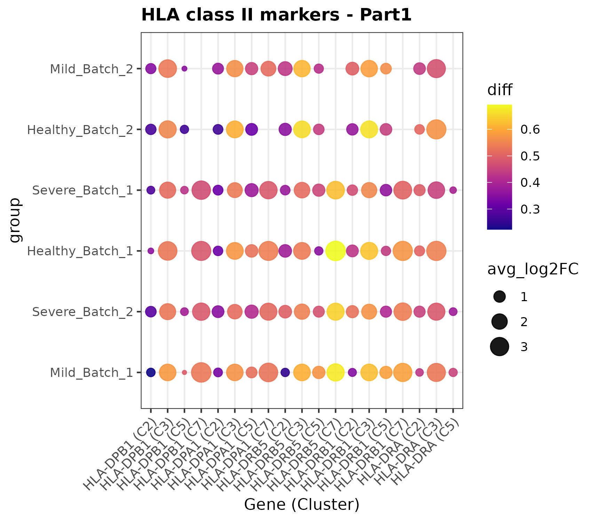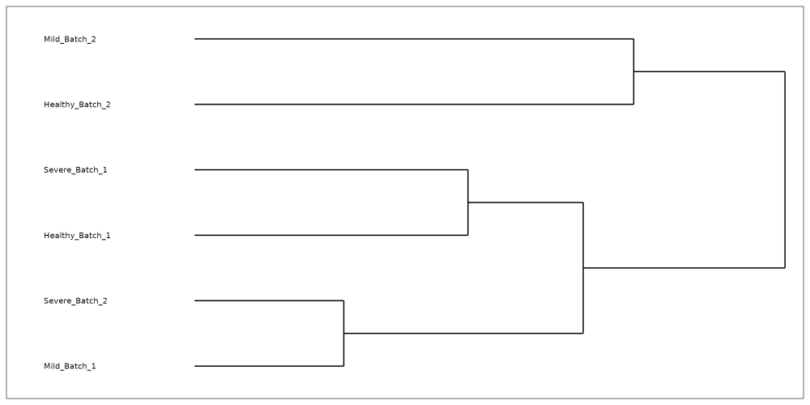

## 3. Pathway enrichment

Both enrichment pipelines take a marker table with one block of genes
per `cluster` and a two-column **TERM2GENE** table, here the MSigDB
Hallmark collection. If the table also has a column whose name contains
`cell_type`, results are additionally summarised per cell type. We
therefore compute markers for the nine `seurat_clusters` (two of which
are CD4 T) and attach their cell type.

``` r

hallmark <- load_hallmark_sets()     # MSigDB Hallmark gene sets; NULL if they cannot be downloaded
have_sets <- !is.null(hallmark)

Idents(pbmc) <- "seurat_clusters"
mk_clusters <- FindTopMarkersAndHeatmap(
  seurat_obj      = pbmc,
  sample_name     = "pbmc3k_clusters",
  onlyPos         = FALSE,             # GSEA needs both tails of the ranking
  output_dir_base = file.path(out_dir, "markers"),
  dpi             = 72
)

enrich_df <- mk_clusters$markers %>%
  mutate(cluster   = as.character(cluster),
         cell_type = as.character(pbmc$cell_type[match(cluster, pbmc$seurat_clusters)]))
```

``` r

dim(enrich_df)
#> [1] 18943     8
dplyr::as_tibble(dplyr::distinct(enrich_df, cluster, cell_type))
#> # A tibble: 8 × 2
#>   cluster cell_type  
#>   <chr>   <chr>      
#> 1 0       CD4 T      
#> 2 1       CD4 T      
#> 3 2       CD14 Mono  
#> 4 3       B          
#> 5 4       CD8 T      
#> 6 5       FCGR3A Mono
#> 7 6       NK         
#> 8 7       DC
```

### Gene Set Enrichment Analysis: `run_global_gsea()`

For every cluster, genes are ranked by `avg_log2FC` and tested with
[`clusterProfiler::GSEA()`](https://rdrr.io/pkg/clusterProfiler/man/GSEA.html).
A first pass collects the NES range of all clusters, so every
per-cluster dot plot shares the same x-axis and can be compared
directly. The function saves per-cluster NES dot plots, a classic
enrichment plot for the top pathway of each cluster, alphabetical and
hierarchically clustered overview dot plots, signed-significance plots
(global and per cell type), and CSV summaries.

``` r

gsea_dir <- file.path(out_dir, "gsea")

gsea_res <- run_global_gsea(
  GSEA_df             = enrich_df,
  m_t2g               = hallmark,
  output_dir          = gsea_dir,
  title_prefix        = "Hallmark",
  top_n_per_direction = 8,
  top_n_overall       = 4
)
```

``` r

gsea_res %>%
  group_by(cluster) %>%
  slice_min(p.adjust, n = 2, with_ties = FALSE) %>%
  dplyr::select(cluster, cell_type, Description, NES, p.adjust) %>%
  arrange(as.numeric(cluster))
#> # A tibble: 13 × 5
#> # Groups:   cluster [7]
#>    cluster cell_type   Description                        NES     p.adjust
#>    <chr>   <chr>       <chr>                            <dbl>        <dbl>
#>  1 0       CD4 T       HALLMARK_ALLOGRAFT_REJECTION     -1.55 0.0441      
#>  2 1       CD4 T       HALLMARK_KRAS_SIGNALING_UP       -1.86 0.000412    
#>  3 1       CD4 T       HALLMARK_ALLOGRAFT_REJECTION     -1.68 0.000412    
#>  4 2       CD14 Mono   HALLMARK_ALLOGRAFT_REJECTION     -2.00 0.000653    
#>  5 2       CD14 Mono   HALLMARK_MYC_TARGETS_V1          -1.93 0.00139     
#>  6 3       B           HALLMARK_COMPLEMENT              -1.97 0.00209     
#>  7 3       B           HALLMARK_INFLAMMATORY_RESPONSE   -1.89 0.00209     
#>  8 4       CD8 T       HALLMARK_KRAS_SIGNALING_UP       -2.11 0.000580    
#>  9 4       CD8 T       HALLMARK_XENOBIOTIC_METABOLISM   -1.88 0.0221      
#> 10 5       FCGR3A Mono HALLMARK_ALLOGRAFT_REJECTION     -2.55 0.0000000219
#> 11 5       FCGR3A Mono HALLMARK_COAGULATION              1.95 0.000692    
#> 12 6       NK          HALLMARK_TNFA_SIGNALING_VIA_NFKB -2.48 0.000177    
#> 13 6       NK          HALLMARK_G2M_CHECKPOINT           2.09 0.000378
```

The clustered overview groups clusters with similar pathway activity.
The two CD4 T clusters (0 and 1) are neighbours, while CD14 monocytes
(cluster 2) and platelets (cluster 8) stand apart. Cluster 2 has
activated inflammatory and TNF-alpha signalling, and cluster 8 has
activated coagulation. Clusters without significant pathways, here the
small DC cluster 7, are left out.

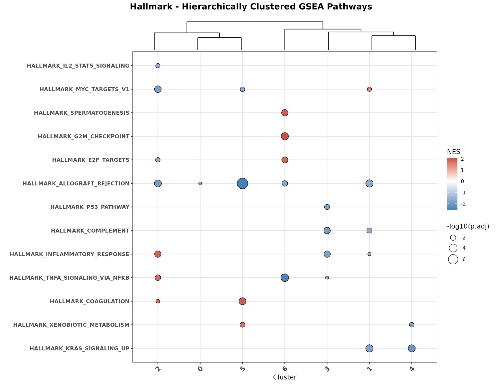

The signed-significance view puts direction and significance on one
axis:

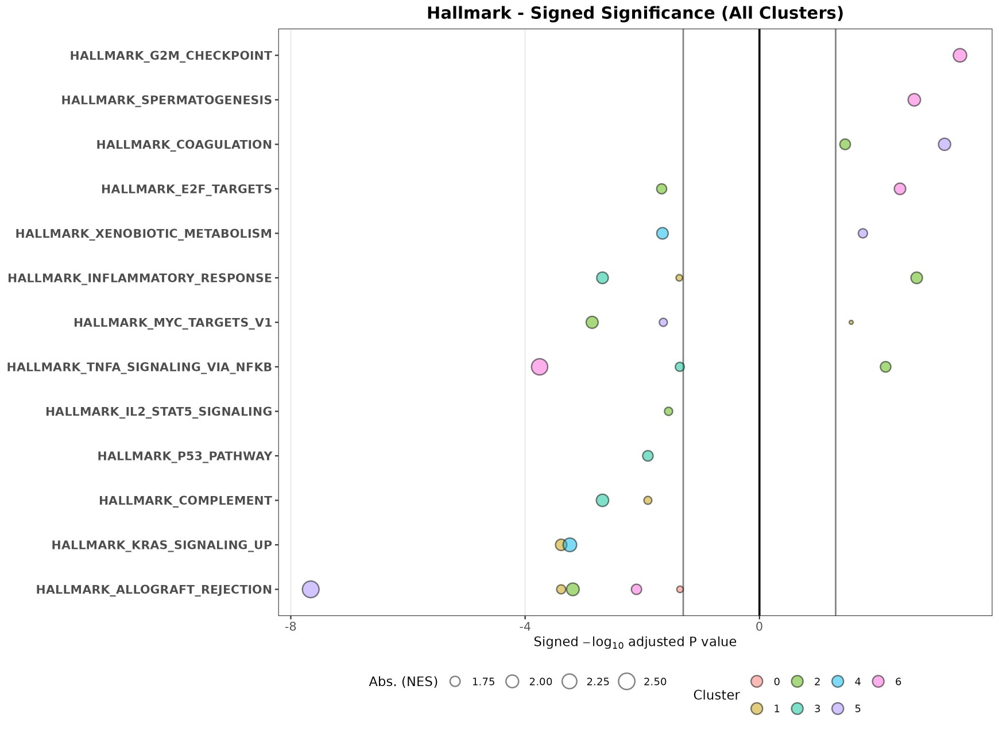

Per-cluster outputs for cluster 2 (CD14 monocytes): the NES dot plot and
the running enrichment score of its top pathway.

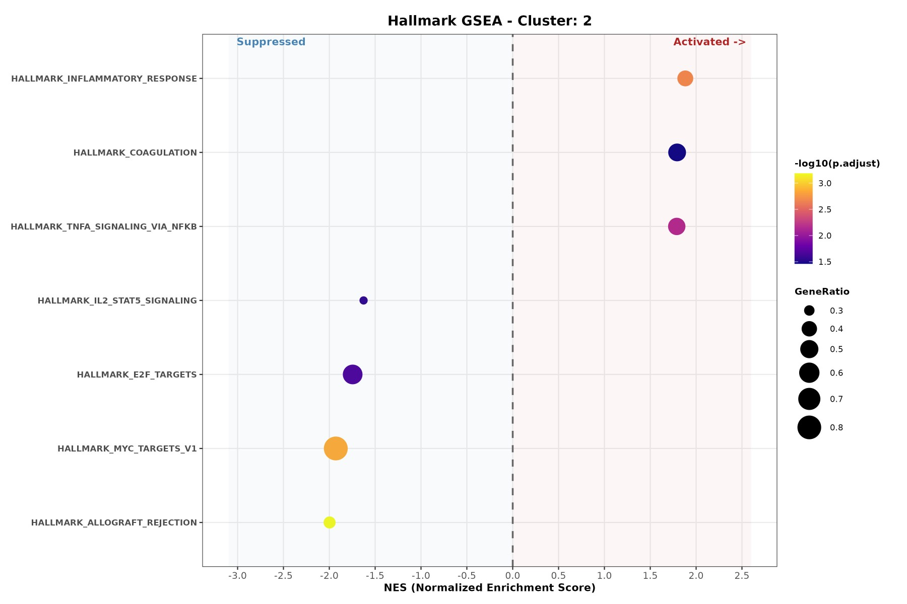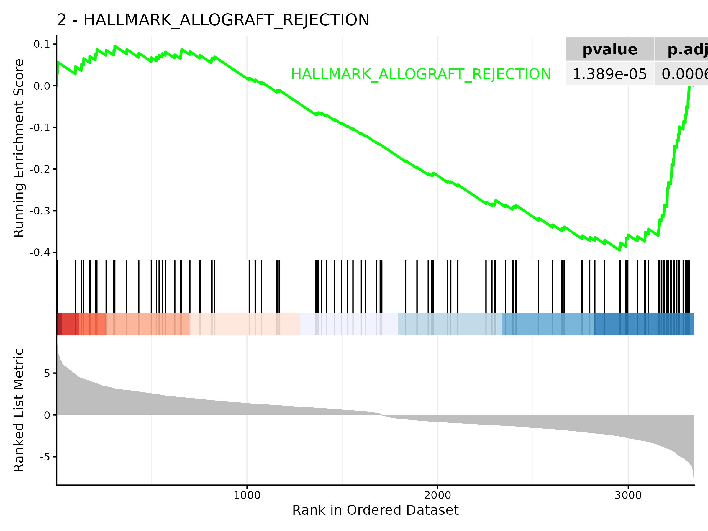

### Over-Representation Analysis: `run_global_ora()`

ORA splits each cluster’s genes into **Activated**
(`avg_log2FC > log2fc_cutoff`) and **Suppressed**
(`avg_log2FC < -log2fc_cutoff`) sets at `p_val_adj < padj_cutoff`, and
tests each set with
[`clusterProfiler::enricher()`](https://rdrr.io/pkg/clusterProfiler/man/enricher.html)
against the universe of all tested genes. With
`variable_per_clus = TRUE`, the function also draws a
signed-significance plot for every cell type.

``` r

ora_dir <- file.path(out_dir, "ora")

ora_res <- run_global_ora(
  ORA_df            = enrich_df,
  m_t2g             = hallmark,
  output_dir        = ora_dir,
  title_prefix      = "Hallmark",
  top_n_global      = 20,
  top_n_per_cluster = 8,
  log2fc_cutoff     = 0.25,
  padj_cutoff       = 0.05,
  global_width      = 11,
  global_height     = 8,
  variable_per_clus = TRUE
)
```

``` r

ora_res %>%
  dplyr::count(cluster, cell_type, Direction) %>%
  arrange(as.numeric(cluster))
#>    cluster   cell_type  Direction n
#> 1        0       CD4 T  Activated 7
#> 2        0       CD4 T Suppressed 4
#> 3        1       CD4 T  Activated 2
#> 4        1       CD4 T Suppressed 5
#> 5        2   CD14 Mono  Activated 5
#> 6        2   CD14 Mono Suppressed 2
#> 7        3           B  Activated 2
#> 8        3           B Suppressed 6
#> 9        4       CD8 T  Activated 2
#> 10       4       CD8 T Suppressed 5
#> 11       5 FCGR3A Mono  Activated 4
#> 12       5 FCGR3A Mono Suppressed 2
#> 13       6          NK  Activated 1
#> 14       6          NK Suppressed 2
#> 15       7          DC Suppressed 1
```

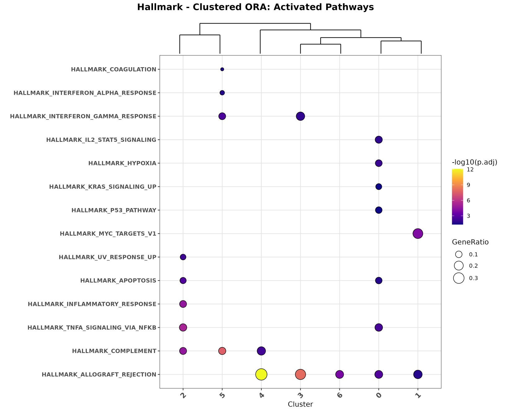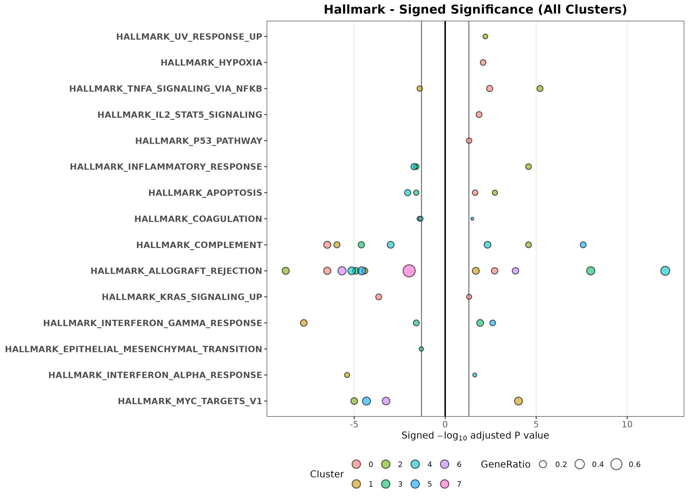

Per-cluster ORA outputs (cluster 2, CD14 monocytes):

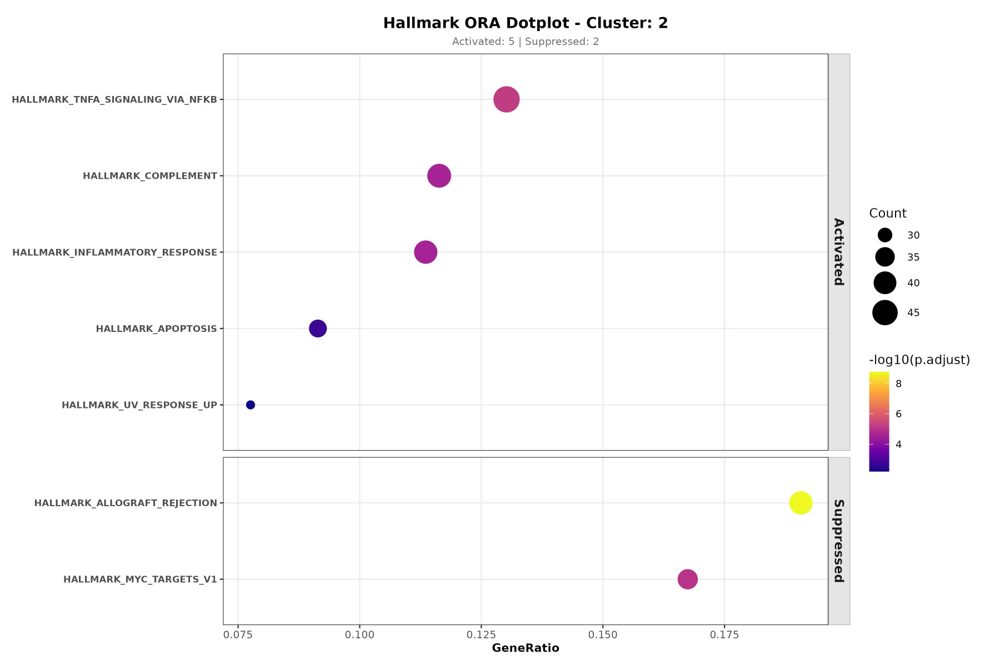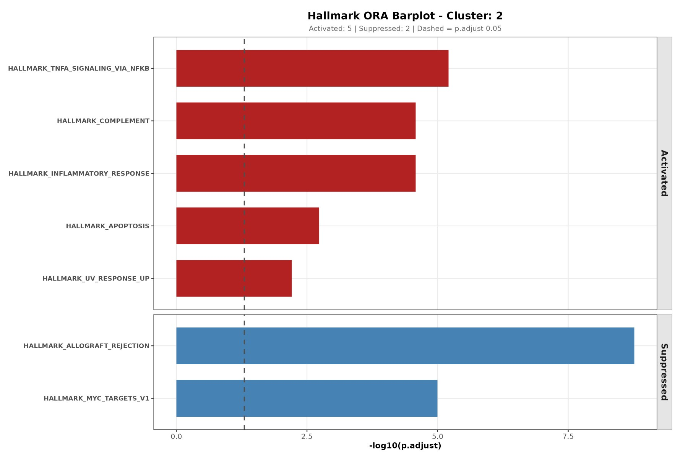

## 4. Pseudo-bulk differential expression with DESeq2

Cluster markers compare cells. A pseudo-bulk analysis compares
**samples**: the counts of each donor x population are summed and
analysed with DESeq2, which correctly models donor-to-donor variability.
Here we compare FCGR3A+ with CD14+ monocytes within the same donors,
using a paired design (`~ donor + subset`).

``` r

mono <- subset(pbmc, subset = cell_type %in% c("CD14 Mono", "FCGR3A Mono"))
mono$subset <- ifelse(mono$cell_type == "CD14 Mono", "CD14", "FCGR3A")

pb <- AggregateExpression(mono, assays = "RNA", group.by = c("donor_id", "subset"),
                          return.seurat = FALSE)$RNA
coldata <- data.frame(
  row.names = colnames(pb),
  donor     = sub("_.*$", "", colnames(pb)),
  subset    = factor(sub("^.*_", "", colnames(pb)), levels = c("CD14", "FCGR3A"))
)
coldata$severity <- pbmc$severity[match(coldata$donor, pbmc$donor_id)]

dds <- DESeqDataSetFromMatrix(round(pb), colData = coldata, design = ~ donor + subset)
dds <- dds[rowSums(counts(dds) >= 10) >= 3, ]
dds <- DESeq(dds, quiet = TRUE)

res_df <- as.data.frame(results(dds, contrast = c("subset", "FCGR3A", "CD14")))
head(res_df[order(res_df$padj), c("baseMean", "log2FoldChange", "padj")])
#>         baseMean log2FoldChange          padj
#> LYZ    723.15192      -2.754455 1.411370e-313
#> S100A9 468.42638      -3.446815 6.226475e-243
#> S100A8 240.60757      -4.187309 1.249838e-104
#> IFITM2 127.76440       2.048881  4.342559e-66
#> RPS19  425.32590       1.018986  6.593423e-62
#> FCGR3A  72.34323       4.748685  8.892743e-54
```

### Volcano trio: `generate_volcano_trio()`

The function expects a data frame with gene symbols as row names and the
DESeq2 columns `log2FoldChange` and `padj`. Seurat results can be used
after renaming `avg_log2FC` and `p_val_adj`. It returns three volcano
plots (made with EnhancedVolcano) that label, in turn, the top 10 up-
and down-regulated genes, the significant genes from your own
`target_genes` list, and both together. Genes are labelled only if they
pass `padj < 0.05` and `|log2FC| >= 1`.

``` r

volcano <- generate_volcano_trio(
  res          = res_df,
  main_title   = "FCGR3A+ vs CD14+ monocytes (pseudo-bulk, paired by donor)",
  target_genes = c("FCGR3A", "MS4A7", "CDKN1C", "LST1", "CSF1R",
                   "CD14", "LYZ", "S100A8", "VCAN", "CCR2")
)
volcano
```


### Heatmap of the top genes: `get_top_mixed_genes()` and `generate_and_save_heatmap()`

[`get_top_mixed_genes()`](https://chomchonu.github.io/OHMmy/reference/get_top_mixed_genes.md)
returns the union of the `n_padj` most significant genes and the `n_lfc`
genes with the largest effect, chosen among the strictly significant
ones. This way neither highly significant small changes nor large
effects in lowly expressed genes are missed.

``` r

top_genes <- get_top_mixed_genes(res_df, n_padj = 25, n_lfc = 25)
length(top_genes)
#> [1] 40
head(top_genes, 15)
#>  [1] "LYZ"    "S100A9" "S100A8" "IFITM2" "RPS19"  "FCGR3A" "LGALS2" "LST1"  
#>  [9] "FCER1G" "RHOC"   "MS4A7"  "GSTP1"  "MS4A6A" "CD14"   "CCL3"
```

[`generate_and_save_heatmap()`](https://chomchonu.github.io/OHMmy/reference/generate_and_save_heatmap.md)
uses these genes to draw two row-scaled heatmaps of the
variance-stabilised counts. The left heatmap keeps your sample order
(`ordered_samps`) and the right one clusters the samples freely.

``` r

vsd <- vst(dds, blind = FALSE)

anno_col <- as.data.frame(colData(vsd)[, c("subset", "severity")])
ordered_samples <- rownames(anno_col)[order(anno_col$subset, anno_col$severity)]

heatmap_dir <- file.path(out_dir, "deseq2")

generate_and_save_heatmap(
  res_obj       = res_df,
  comp_name     = "FCGR3A_vs_CD14",
  comp_title    = "FCGR3A+ vs CD14+ monocytes",
  vsd_data      = vsd,
  anno_col      = anno_col,
  ordered_samps = ordered_samples,
  n_padj        = 25,
  n_lfc         = 25,
  out_dir       = heatmap_dir,
  ts            = format(Sys.time(), "%Y%m%d_%H%M%S"),
  clus          = "Monocytes"
)
```

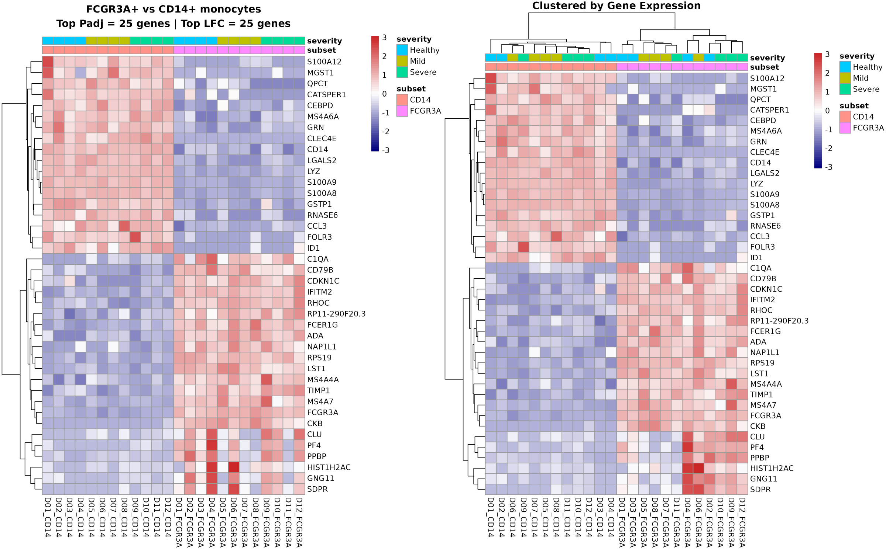

In the unordered (right) heatmap the samples split by monocyte subset,
not by the simulated severity. This is expected, because severity was
simulated and has no transcriptional effect.

## Session information

``` r

sessionInfo()
#> R version 4.6.2 (2026-10-29)
#> Platform: x86_64-pc-linux-gnu
#> Running under: Ubuntu 22.04.5 LTS
#> 
#> Matrix products: default
#> BLAS:   /usr/lib/x86_64-linux-gnu/openblas-pthread/libblas.so.3 
#> LAPACK: /usr/lib/x86_64-linux-gnu/openblas-pthread/libopenblasp-r0.3.20.so;  LAPACK version 3.10.0
#> 
#> locale:
#>  [1] LC_CTYPE=C.UTF-8       LC_NUMERIC=C           LC_TIME=C.UTF-8       
#>  [4] LC_COLLATE=C.UTF-8     LC_MONETARY=C.UTF-8    LC_MESSAGES=C.UTF-8   
#>  [7] LC_PAPER=C.UTF-8       LC_NAME=C              LC_ADDRESS=C          
#> [10] LC_TELEPHONE=C         LC_MEASUREMENT=C.UTF-8 LC_IDENTIFICATION=C   
#> 
#> time zone: UTC
#> tzcode source: system (glibc)
#> 
#> attached base packages:
#> [1] stats4    stats     graphics  grDevices utils     datasets  methods  
#> [8] base     
#> 
#> other attached packages:
#>  [1] future_1.82.0               DESeq2_1.52.0              
#>  [3] SummarizedExperiment_1.42.0 Biobase_2.72.0             
#>  [5] MatrixGenerics_1.24.0       matrixStats_1.5.0          
#>  [7] GenomicRanges_1.64.0        Seqinfo_1.2.0              
#>  [9] IRanges_2.46.0              S4Vectors_0.50.3           
#> [11] BiocGenerics_0.58.1         generics_0.1.4             
#> [13] msigdbr_26.1.1              ggplot2_4.0.3              
#> [15] dplyr_1.2.1                 OHMmy_1.0.2.9000           
#> [17] Seurat_6.0.0                SeuratObject_5.4.0         
#> [19] sp_2.2-4                   
#> 
#> loaded via a namespace (and not attached):
#>   [1] RcppAnnoy_0.0.23        splines_4.6.2           ggplotify_0.1.4        
#>   [4] tibble_3.3.1            polyclip_1.10-7         enrichit_0.2.7         
#>   [7] rpart_4.1.27            fastDummies_1.7.6       lifecycle_1.0.5        
#>  [10] httr2_1.3.0             rstatix_1.1.0           globals_0.20.0         
#>  [13] processx_3.9.0          lattice_0.23-1          MASS_7.3-66            
#>  [16] backports_1.5.1         magrittr_2.0.5          sass_0.4.10            
#>  [19] rmarkdown_2.32          jquerylib_0.1.4         yaml_2.3.12            
#>  [22] ggtangle_0.1.5          otel_0.3.0              sctransform_0.4.3      
#>  [25] spam_2.11-4             EnhancedVolcano_1.30.0  cowplot_1.2.0          
#>  [28] pbapply_1.7-5           DBI_1.3.0               RColorBrewer_1.1-3     
#>  [31] abind_1.4-8             Rtsne_0.17              purrr_1.2.2            
#>  [34] ggraph_2.2.2            yulab.utils_0.2.5       tweenr_2.0.3           
#>  [37] rappdirs_0.3.4          aisdk_1.4.12            gdtools_0.5.3          
#>  [40] enrichplot_1.32.1       ggrepel_0.9.8           irlba_2.4.1            
#>  [43] listenv_1.1.0           tidytree_0.4.8          pheatmap_1.0.13        
#>  [46] RSpectra_0.16-2         parallelly_1.50.0       pkgdown_2.2.1          
#>  [49] codetools_0.2-20        DelayedArray_0.38.2     DOSE_4.6.0             
#>  [52] ggforce_0.5.0           tidyselect_1.2.1        aplot_0.3.2            
#>  [55] farver_2.1.2            SoupX_1.6.2             viridis_0.6.5          
#>  [58] jsonlite_2.0.0          tidygraph_1.3.1         progressr_1.1.0        
#>  [61] Formula_1.2-6           ggridges_0.5.7          systemfonts_1.3.2      
#>  [64] ggnewscale_0.5.2        tools_4.6.2             treeio_1.36.1          
#>  [67] ragg_1.5.2              ica_1.0-3               Rcpp_1.1.2             
#>  [70] glue_1.8.1              gridExtra_2.3.1         SparseArray_1.12.3     
#>  [73] xfun_0.62               qvalue_2.44.0           withr_3.0.3            
#>  [76] fastmap_1.2.0           callr_3.8.0             digest_0.6.39          
#>  [79] gridGraphics_0.5-1      R6_2.6.1                textshaping_1.0.5      
#>  [82] scattermore_1.2         GO.db_3.23.1            jpeg_0.1-11            
#>  [85] RSQLite_3.53.3          utf8_1.2.6              tidyr_1.3.2            
#>  [88] fontLiberation_0.1.0    pls_2.9-0               graphlayouts_1.2.5     
#>  [91] httr_1.4.9              htmlwidgets_1.6.4       S4Arrays_1.12.1        
#>  [94] scatterpie_0.2.6        uwot_0.2.5              pkgconfig_2.0.3        
#>  [97] gtable_0.3.6            blob_1.3.0              S7_0.2.2               
#> [100] XVector_0.52.0          clusterProfiler_4.20.3  htmltools_0.5.9        
#> [103] fontBitstreamVera_0.1.1 carData_3.0-6           dotCall64_1.2          
#> [106] scales_1.4.0            png_0.1-9               ggfun_0.2.2            
#> [109] ggdendro_0.2.0          knitr_1.52              reshape2_1.4.5         
#> [112] nlme_3.1-171            cachem_1.1.0            stringr_1.6.0          
#> [115] KernSmooth_2.23-27      parallel_4.6.2          AnnotationDbi_1.74.0   
#> [118] desc_1.4.3              pillar_1.11.1           grid_4.6.2             
#> [121] vctrs_0.7.3             RANN_2.6.3              ggpubr_1.0.0           
#> [124] tidydr_0.0.7            car_3.1-5               cluster_2.1.8.3        
#> [127] evaluate_1.0.5          cli_3.6.6               locfit_1.5-9.12        
#> [130] compiler_4.6.2          rlang_1.3.0             crayon_1.5.3           
#> [133] leidenbase_0.1.37       future.apply_1.21.0     ggsignif_0.6.4         
#> [136] labeling_0.4.3          ps_1.9.3                plyr_1.8.9             
#> [139] fs_2.1.0                ggiraph_0.9.6           stringi_1.8.9          
#> [142] viridisLite_0.4.3       BiocParallel_1.46.0     assertthat_0.2.1       
#> [145] Biostrings_2.80.2       lazyeval_0.2.3          fontquiver_0.2.1       
#> [148] GOSemSim_2.38.3         Matrix_1.7-6            RcppHNSW_0.7.0         
#> [151] patchwork_1.3.2         bit64_4.8.6             KEGGREST_1.52.2        
#> [154] igraph_2.3.4            broom_1.0.13            memoise_2.0.1          
#> [157] bslib_0.12.0            ggtree_4.2.1            bit_4.6.0              
#> [160] gson_0.2.2              ape_5.8-1
```
