# Differential Expression and Pathway Enrichment

## Overview

This article goes from cluster markers to pathways and pseudo-bulk
differential expression.

| Step | Functions |
|----|----|
| Cluster markers | [`FindTopMarkersAndHeatmap()`](https://chomchonu.github.io/OHMmy/reference/FindTopMarkersAndHeatmap.md) |
| Markers across resolutions, dichotomous key | [`find_hierarchical_markers()`](https://chomchonu.github.io/OHMmy/reference/find_hierarchical_markers.md) |
| Marker tables across conditions | [`plot_gene_markers_with_dendro()`](https://chomchonu.github.io/OHMmy/reference/plot_gene_markers_with_dendro.md), [`plot_split_dotplots_by_gene_cluster()`](https://chomchonu.github.io/OHMmy/reference/plot_split_dotplots_by_gene_cluster.md) |
| Pathway enrichment | [`run_global_gsea()`](https://chomchonu.github.io/OHMmy/reference/run_global_gsea.md), [`run_global_ora()`](https://chomchonu.github.io/OHMmy/reference/run_global_ora.md) |
| Pseudo-bulk DESeq2 visualisation | [`generate_volcano_trio()`](https://chomchonu.github.io/OHMmy/reference/generate_volcano_trio.md), [`get_top_mixed_genes()`](https://chomchonu.github.io/OHMmy/reference/get_top_mixed_genes.md), [`generate_and_save_heatmap()`](https://chomchonu.github.io/OHMmy/reference/generate_and_save_heatmap.md) |

``` r

library(Seurat)
library(OHMmy)
library(dplyr)
library(ggplot2)
source("ohmmy-vignette-helpers.R")

library(msigdbr)   # MSigDB gene sets
library(DESeq2)    # pseudo-bulk differential expression

pbmc <- load_pbmc3k_ohmmy()   # built in "Data Processing, Integration, and Clustering"
out_dir <- file.path(tempdir(), "OHMmy-differential-expression")
dir.create(out_dir, recursive = TRUE, showWarnings = FALSE)
```

The classic GSEA enrichment plots and the volcano plots additionally use
the suggested packages **enrichplot** and **EnhancedVolcano**. OHMmy
calls them internally, so they only need to be installed.

## 1. Cluster markers with `FindTopMarkersAndHeatmap()`

[`FindTopMarkersAndHeatmap()`](https://chomchonu.github.io/OHMmy/reference/FindTopMarkersAndHeatmap.md)
runs
[`FindAllMarkers()`](https://satijalab.org/seurat/reference/FindAllMarkers.html)
on the active identities, or
[`FindMarkers()`](https://satijalab.org/seurat/reference/FindMarkers.html)
for a single pairwise comparison when `compare` is given. It uses
`logfc.threshold = 0` and `min.pct = 0`, so the complete ranked table
needed for GSEA is kept. Markers are then ranked by a combined relevance
score, `|log2FC| x |pct.1 - pct.2| / p_adj`, filtered by the three
`marker_*` thresholds, and the top `top_n` per cluster are drawn in a
`DoHeatmap`. Three CSV files are written: all markers, a GSEA/ORA-ready
copy, and the filtered top markers.

``` r

Idents(pbmc) <- "cell_type"

mk <- FindTopMarkersAndHeatmap(
  seurat_obj      = pbmc,
  sample_name     = "pbmc3k_celltype",
  top_n           = 6,
  onlyPos         = TRUE,
  output_dir_base = file.path(out_dir, "markers"),
  height          = 11,
  dpi             = 100
)
```

``` r

names(mk)
#> [1] "top_markers" "heatmap"     "markers"     "output_dir"
mk$top_markers %>%
  group_by(cluster) %>%
  slice_head(n = 3) %>%
  dplyr::select(cluster, gene, avg_log2FC, pct.1, pct.2, p_val_adj, score)
#> # A tibble: 24 × 7
#> # Groups:   cluster [8]
#>    cluster gene   avg_log2FC pct.1 pct.2 p_val_adj        score
#>    <fct>   <chr>       <dbl> <dbl> <dbl>     <dbl>        <dbl>
#>  1 CD4 T   CD3D         1.85 0.876 0.239         0 11779171720.
#>  2 CD4 T   MAL          4.27 0.275 0.022         0 10791029183.
#>  3 CD4 T   IL7R         2.11 0.662 0.198         0  9799217999.
#>  4 CD8 T   CCL5         3.28 0.99  0.234         0 24818859926.
#>  5 CD8 T   GZMK         4.31 0.571 0.057         0 22147169959.
#>  6 CD8 T   NKG7         2.46 0.951 0.219         0 17986601144.
#>  7 NK      GZMB         5.95 0.955 0.068         0 52784613288.
#>  8 NK      GNLY         6.12 0.961 0.131         0 50765745316.
#>  9 NK      FGFBP2       5.33 0.871 0.062         0 43108924263.
#> 10 B       CD79A        6.85 0.938 0.042         0 61335103114.
#> # ℹ 14 more rows
mk$heatmap
```

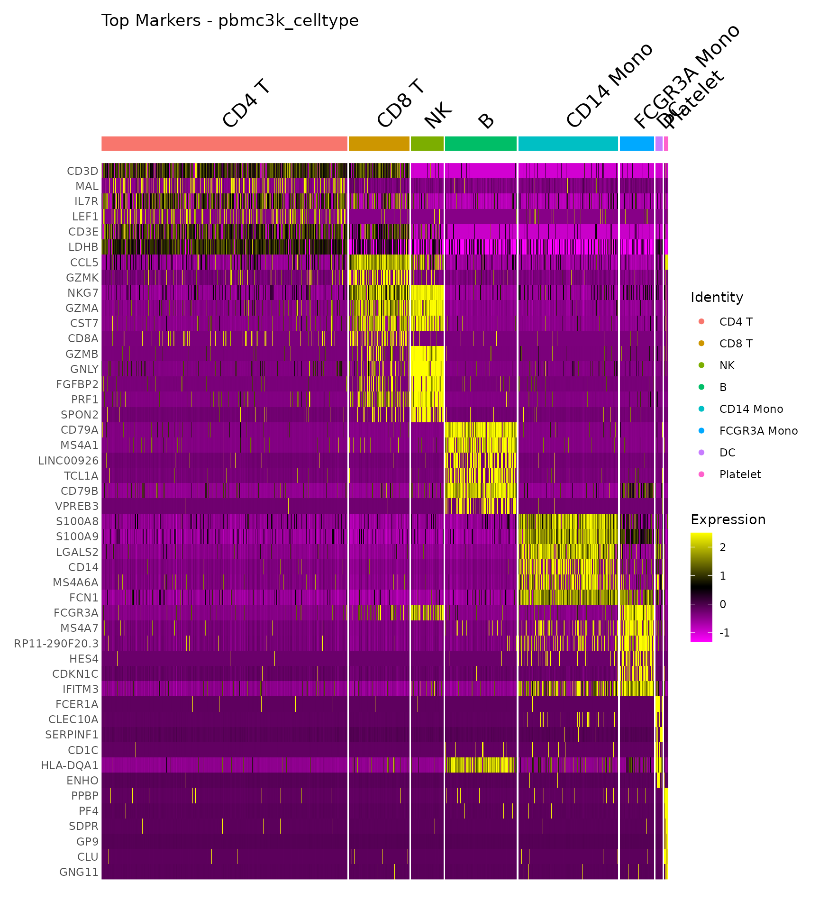

### Pairwise comparison

With `compare = c(ident.1, ident.2)`, the function runs a single
[`FindMarkers()`](https://satijalab.org/seurat/reference/FindMarkers.html)
test. It adds the `gene` and `cluster` columns (each gene is assigned to
the identity in which it is higher), so the output has the same format
as the all-cluster version. With `onlyPos = FALSE`, genes enriched on
both sides are kept.

``` r

mk_mono <- FindTopMarkersAndHeatmap(
  seurat_obj      = subset(pbmc, subset = cell_type %in% c("CD14 Mono", "FCGR3A Mono")),
  sample_name     = "pbmc3k_monocytes",
  compare         = c("FCGR3A Mono", "CD14 Mono"),
  onlyPos         = FALSE,
  top_n           = 10,
  output_dir_base = file.path(out_dir, "markers"),
  height          = 7,
  dpi             = 100
)
```

``` r

table(mk_mono$top_markers$cluster)
#> 
#>   CD14 Mono FCGR3A Mono 
#>          10          10
mk_mono$heatmap
```

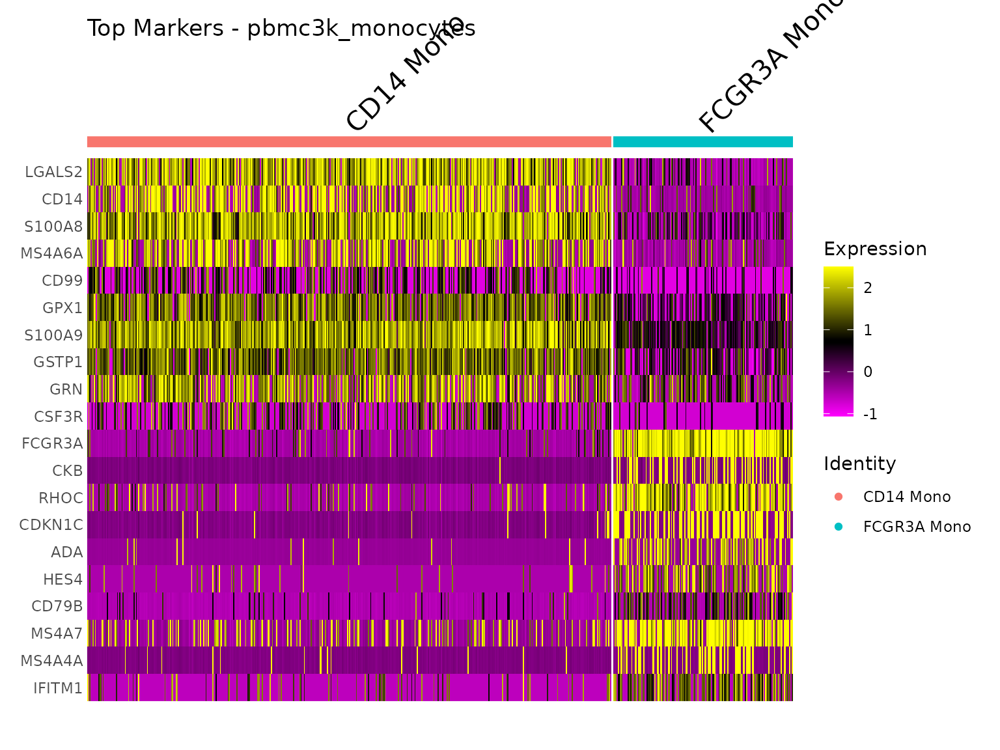

### Markers across resolutions: a dichotomous key

Low resolutions separate the major populations and higher resolutions
split them into sub-populations.
[`find_hierarchical_markers()`](https://chomchonu.github.io/OHMmy/reference/find_hierarchical_markers.md)
follows the clusters from low to high resolution. It links each cluster
to the lower-resolution cluster that holds most of its cells, and that
share is reported as `purity`. At every split it compares each child
**with its siblings only**, so broad markers shared by all children (for
example *CD3E* within T cells) do not reappear at the finer levels.

Markers must pass four filters: adjusted p-value, log2FC, `pct.1` and
`pct.1 - pct.2`. They are then ranked by **AUC**, the probability that a
random child cell expresses the gene more highly than a random sibling
cell (0.5 = no separation, 1 = perfect). The clusters were defined on
the same data, so the p-values are optimistic. They work as a filter,
not as evidence on their own.

``` r

hm <- find_hierarchical_markers(
  seurat_obj  = pbmc,
  res_cols    = c("har_snn_res.0.2", "har_snn_res.0.6", "har_snn_res.1.2"),
  sample_name = "pbmc3k",
  output_dir  = file.path(out_dir, "hierarchical_markers")
)
```

`hm$splits` summarises each split. `hm$markers` holds every gene that
passed the filters, with its rank, AUC, the usual DE statistics and a
`pattern`:

| Pattern | Meaning |
|----|----|
| `lineage` | Marks this child, but does not separate its own sub-clusters (shared by all of them) |
| `split` | Separates this child from its siblings |
| `specific` | The child does not split further, and the gene also separates it from all other cells (`auc_vs_all >= 0.8`) |
| `unstable` | The child has purity below `min_purity`: its cells came from more than one parent, so the split is not clean across resolutions |

``` r

hm$splits[, c("split", "children", "n_markers", "n_key_genes", "cv_accuracy")]
#>      split                               children n_markers n_key_genes
#> 1     root res0.2_0, res0.2_1, res0.2_2, res0.2_3       143           3
#> 2 res0.2_0                     res0.6_0, res0.6_1         5           1
#> 3 res0.2_1 res0.6_2, res0.6_5, res0.6_7, res0.6_8       100           2
#> 4 res0.2_2                     res0.6_4, res0.6_6        32           3
#> 5 res0.6_0                    res1.2_0, res1.2_10        19           1
#> 6 res0.6_1                     res1.2_1, res1.2_6         1           0
#> 7 res0.6_2                     res1.2_4, res1.2_5        28           2
#>   cv_accuracy
#> 1   0.9613343
#> 2   0.6632302
#> 3   0.9269747
#> 4   0.9153318
#> 5   0.9699647
#> 6   1.0000000
#> 7   0.6857749
hm$markers %>%
  group_by(split, child) %>%
  slice_head(n = 2) %>%
  dplyr::select(split, child, gene, rank, auc, p_val_adj, pct.1, pct.2, pattern)
#> # A tibble: 25 × 9
#> # Groups:   split, child [13]
#>    split    child    gene      rank   auc p_val_adj pct.1 pct.2 pattern 
#>    <chr>    <chr>    <chr>    <int> <dbl>     <dbl> <dbl> <dbl> <chr>   
#>  1 res0.2_0 res0.6_0 ANXA1        1 0.723         0 0.8   0.425 lineage 
#>  2 res0.2_0 res0.6_0 S100A11      2 0.704         0 0.616 0.225 lineage 
#>  3 res0.2_1 res0.6_2 S100A8       1 0.945         0 0.973 0.492 lineage 
#>  4 res0.2_1 res0.6_2 LGALS2       2 0.871         0 0.903 0.381 lineage 
#>  5 res0.2_1 res0.6_5 FCGR3A       1 0.979         0 0.981 0.128 specific
#>  6 res0.2_1 res0.6_5 IFITM2       2 0.938         0 1     0.692 specific
#>  7 res0.2_1 res0.6_7 HLA-DQA1     1 0.937         0 0.943 0.272 specific
#>  8 res0.2_1 res0.6_7 HLA-DQB1     2 0.927         0 0.943 0.307 specific
#>  9 res0.2_2 res0.6_4 CD3D         1 0.904         0 0.879 0.097 split   
#> 10 res0.2_2 res0.6_4 GZMK         2 0.739         0 0.571 0.116 split   
#> # ℹ 15 more rows
```

For each split, a decision tree (**rpart**) is grown on the top-ranked
markers and pruned by cross-validation, so each split gets as many genes
as it needs. `hm$key` lists every question of the key. The chosen gene
has `role = "key"`. The `role = "backup"` rows are genes that sort the
cells almost the same way, with their `agreement`. Every row carries the
same ranking columns as `hm$markers`.

``` r

hm$key %>%
  dplyr::select(split, role, gene, rule, agreement, rank, auc, pct.1, pct.2, pattern)
#>        split   role          gene                              rule  agreement
#> 1       root    key          CST3          CST3 >= 2.71 -> res0.2_1         NA
#> 2       root backup           LYZ           LYZ >= 2.91 -> res0.2_1 0.86458333
#> 3       root backup          AIF1          AIF1 >= 2.33 -> res0.2_1 0.83184524
#> 4       root backup          LST1           LST1 >= 2.2 -> res0.2_1 0.82440476
#> 5       root backup        TYROBP        TYROBP >= 2.87 -> res0.2_1 0.81398810
#> 6       root backup        S100A9        S100A9 >= 2.29 -> res0.2_1 0.79761905
#> 7       root backup          FCN1          FCN1 >= 2.07 -> res0.2_1 0.74404762
#> 8       root backup        LGALS1        LGALS1 >= 2.88 -> res0.2_1 0.72470238
#> 9       root backup          TYMP          TYMP >= 1.92 -> res0.2_1 0.70982143
#> 10      root backup          CTSS          CTSS >= 2.51 -> res0.2_1 0.69940476
#> 11      root backup         COTL1         COTL1 >= 2.76 -> res0.2_1 0.69047619
#> 12      root    key          NKG7           NKG7 >= 2.3 -> res0.2_2         NA
#> 13      root backup          CST7          CST7 >= 1.73 -> res0.2_2 0.67727273
#> 14      root backup          GZMA           GZMA >= 1.7 -> res0.2_2 0.63409091
#> 15      root backup          CCL5          CCL5 >= 2.56 -> res0.2_2 0.57272727
#> 16      root backup          CTSW          CTSW >= 2.31 -> res0.2_2 0.53181818
#> 17      root backup          PRF1          PRF1 >= 1.63 -> res0.2_2 0.52727273
#> 18      root backup          GZMB           GZMB >= 1.7 -> res0.2_2 0.46818182
#> 19      root backup          GNLY           GNLY >= 2.2 -> res0.2_2 0.46590909
#> 20      root backup        FGFBP2        FGFBP2 >= 1.55 -> res0.2_2 0.46363636
#> 21      root backup          GZMM          GZMM >= 1.76 -> res0.2_2 0.32727273
#> 22      root backup          SRGN          SRGN >= 2.38 -> res0.2_2 0.29318182
#> 23      root    key       HLA-DRA       HLA-DRA >= 3.24 -> res0.2_3         NA
#> 24      root backup      HLA-DPB1      HLA-DPB1 >= 2.62 -> res0.2_3 0.89380531
#> 25      root backup         CD79A         CD79A >= 1.83 -> res0.2_3 0.87020649
#> 26      root backup      HLA-DRB1      HLA-DRB1 >= 2.53 -> res0.2_3 0.86725664
#> 27      root backup      HLA-DPA1      HLA-DPA1 >= 2.44 -> res0.2_3 0.84660767
#> 28      root backup         CD79B         CD79B >= 1.89 -> res0.2_3 0.82595870
#> 29      root backup      HLA-DQA1      HLA-DQA1 >= 1.73 -> res0.2_3 0.82005900
#> 30      root backup         MS4A1         MS4A1 >= 1.67 -> res0.2_3 0.75811209
#> 31      root backup      HLA-DRB5      HLA-DRB5 >= 1.77 -> res0.2_3 0.72566372
#> 32      root backup      HLA-DQB1      HLA-DQB1 >= 1.84 -> res0.2_3 0.72271386
#> 33      root backup         TCL1A         TCL1A >= 1.77 -> res0.2_3 0.56637168
#> 34  res0.2_0    key       S100A11      S100A11 >= 0.512 -> res0.6_0         NA
#> 35  res0.2_0 backup         ANXA1         ANXA1 >= 2.26 -> res0.6_0 0.13562753
#> 36  res0.2_0 backup       S100A10        S100A10 >= 2.5 -> res0.6_0 0.10121457
#> 37  res0.2_0 backup         CLIC1         CLIC1 >= 1.61 -> res0.6_0 0.06680162
#> 38  res0.2_0 backup          KLF6          KLF6 >= 2.55 -> res0.6_0 0.05060729
#> 39  res0.2_1    key        FCGR3A        FCGR3A >= 2.03 -> res0.6_5         NA
#> 40  res0.2_1 backup        IFITM2        IFITM2 >= 3.03 -> res0.6_5 0.52980132
#> 41  res0.2_1 backup          RHOC          RHOC >= 1.83 -> res0.6_5 0.41059603
#> 42  res0.2_1 backup        S100A8        S100A8 >= 1.71 -> res0.6_2 0.39735099
#> 43  res0.2_1 backup        LGALS2        LGALS2 >= 1.41 -> res0.6_2 0.38410596
#> 44  res0.2_1 backup        CDKN1C       CDKN1C >= 0.437 -> res0.6_5 0.37748344
#> 45  res0.2_1 backup         MS4A7         MS4A7 >= 2.21 -> res0.6_5 0.35761589
#> 46  res0.2_1 backup          HES4         HES4 >= 0.517 -> res0.6_5 0.25827815
#> 47  res0.2_1 backup         CD79B         CD79B >= 1.01 -> res0.6_5 0.24503311
#> 48  res0.2_1 backup RP11-290F20.3 RP11-290F20.3 >= 2.23 -> res0.6_5 0.17218543
#> 49  res0.2_1 backup        LILRB1       LILRB1 >= 0.994 -> res0.6_5 0.15894040
#> 50  res0.2_1    key        FCER1A       FCER1A >= 0.408 -> res0.6_7         NA
#> 51  res0.2_1 backup      HLA-DQA1      HLA-DQA1 >= 2.88 -> res0.6_7 0.47058824
#> 52  res0.2_1 backup      HLA-DQB1      HLA-DQB1 >= 2.92 -> res0.6_7 0.38235294
#> 53  res0.2_1 backup          CD1C          CD1C >= 1.41 -> res0.6_7 0.29411765
#> 54  res0.2_1 backup       CLEC10A       CLEC10A >= 1.86 -> res0.6_7 0.26470588
#> 55  res0.2_1 backup      HLA-DQA2      HLA-DQA2 >= 2.07 -> res0.6_7 0.14705882
#> 56  res0.2_1 backup         CXCR4          CXCR4 >= 2.9 -> res0.6_7 0.02941176
#> 57  res0.2_2    key          GNLY          GNLY >= 3.53 -> res0.6_6         NA
#> 58  res0.2_2 backup          CD3D         CD3D >= 0.705 -> res0.6_4 0.57516340
#> 59  res0.2_2 backup        TYROBP        TYROBP >= 1.97 -> res0.6_6 0.57516340
#> 60  res0.2_2 backup        FCER1G        FCER1G >= 1.91 -> res0.6_6 0.56209150
#> 61  res0.2_2 backup          GZMB          GZMB >= 3.33 -> res0.6_6 0.52287582
#> 62  res0.2_2 backup        IGFBP7        IGFBP7 >= 0.59 -> res0.6_6 0.40522876
#> 63  res0.2_2 backup          PRF1          PRF1 >= 2.91 -> res0.6_6 0.39869281
#> 64  res0.2_2 backup        FCGR3A        FCGR3A >= 1.94 -> res0.6_6 0.37908497
#> 65  res0.2_2 backup          IL32          IL32 >= 1.55 -> res0.6_4 0.34640523
#> 66  res0.2_2 backup         SPON2         SPON2 >= 1.46 -> res0.6_6 0.31372549
#> 67  res0.2_2 backup         KLRD1         KLRD1 >= 1.74 -> res0.6_6 0.30718954
#> 68  res0.2_2    key        TYROBP        TYROBP >= 2.85 -> res0.6_6         NA
#> 69  res0.2_2 backup        FCER1G        FCER1G >= 2.56 -> res0.6_6 0.61538462
#> 70  res0.2_2 backup         CD247         CD247 >= 2.93 -> res0.6_6 0.30769231
#> 71  res0.2_2 backup          GZMB          GZMB >= 3.63 -> res0.6_6 0.15384615
#> 72  res0.2_2 backup        FCGR3A        FCGR3A >= 3.01 -> res0.6_6 0.15384615
#> 73  res0.2_2 backup        FGFBP2        FGFBP2 >= 4.02 -> res0.6_6 0.15384615
#> 74  res0.2_2 backup           CD7           CD7 >= 3.29 -> res0.6_6 0.15384615
#> 75  res0.2_2 backup        IGFBP7        IGFBP7 >= 2.76 -> res0.6_6 0.15384615
#> 76  res0.2_2 backup         SPON2         SPON2 >= 3.31 -> res0.6_6 0.07692308
#> 77  res0.2_2 backup         ITGB2         ITGB2 >= 3.34 -> res0.6_6 0.07692308
#> 78  res0.2_2 backup         CLIC3          CLIC3 >= 2.5 -> res0.6_6 0.07692308
#> 79  res0.2_2    key          CD3D          CD3D >= 2.84 -> res0.6_4         NA
#> 80  res0.2_2 backup          CD8A           CD8A >= 2.4 -> res0.6_4 0.22222222
#> 81  res0.6_0    key         ISG15        ISG15 >= 3.56 -> res1.2_10         NA
#> 82  res0.6_0 backup           MX1          MX1 >= 2.74 -> res1.2_10 0.42857143
#> 83  res0.6_0 backup          MT2A         MT2A >= 3.49 -> res1.2_10 0.35714286
#> 84  res0.6_0 backup         IFIT1         IFIT1 >= 2.7 -> res1.2_10 0.28571429
#> 85  res0.6_0 backup          IFI6         IFI6 >= 3.16 -> res1.2_10 0.21428571
#> 86  res0.6_0 backup         ISG20        ISG20 >= 3.03 -> res1.2_10 0.21428571
#> 87  res0.6_0 backup        EPSTI1       EPSTI1 >= 2.46 -> res1.2_10 0.21428571
#> 88  res0.6_0 backup         IFIT3        IFIT3 >= 2.37 -> res1.2_10 0.14285714
#> 89  res0.6_0 backup         STAT1        STAT1 >= 2.58 -> res1.2_10 0.14285714
#> 90  res0.6_0 backup         IFI35        IFI35 >= 2.69 -> res1.2_10 0.07142857
#> 91  res0.6_0 backup      LGALS3BP     LGALS3BP >= 2.29 -> res1.2_10 0.07142857
#> 92  res0.6_2    key          CPVL         CPVL >= 0.551 -> res1.2_5         NA
#> 93  res0.6_2 backup      HLA-DRB5      HLA-DRB5 >= 2.37 -> res1.2_5 0.11666667
#> 94  res0.6_2 backup      HLA-DQB1     HLA-DQB1 >= 0.579 -> res1.2_5 0.11111111
#> 95  res0.6_2 backup          RNH1          RNH1 >= 2.07 -> res1.2_5 0.06111111
#> 96  res0.6_2 backup     HNRNPA2B1     HNRNPA2B1 >= 1.84 -> res1.2_5 0.05000000
#> 97  res0.6_2 backup      HLA-DPB1      HLA-DPB1 >= 3.11 -> res1.2_5 0.04444444
#> 98  res0.6_2 backup       HLA-DMB       HLA-DMB >= 1.76 -> res1.2_5 0.04444444
#> 99  res0.6_2 backup         ITM2B         ITM2B >= 3.11 -> res1.2_5 0.03888889
#> 100 res0.6_2 backup      APOBEC3A      APOBEC3A >= 2.87 -> res1.2_5 0.01666667
#> 101 res0.6_2 backup           CFP           CFP >= 3.01 -> res1.2_5 0.01666667
#> 102 res0.6_2 backup         PSME2          PSME2 >= 2.8 -> res1.2_5 0.01111111
#> 103 res0.6_2    key          LSP1         LSP1 >= 0.566 -> res1.2_5         NA
#> 104 res0.6_2 backup      HLA-DPB1     HLA-DPB1 >= 0.516 -> res1.2_5 0.15094340
#> 105 res0.6_2 backup      SERPINA1     SERPINA1 >= 0.551 -> res1.2_5 0.09433962
#> 106 res0.6_2 backup          SPI1         SPI1 >= 0.516 -> res1.2_5 0.07547170
#> 107 res0.6_2 backup          ENO1         ENO1 >= 0.627 -> res1.2_5 0.07547170
#> 108 res0.6_2 backup          CPVL          CPVL >= 3.11 -> res1.2_4 0.05660377
#> 109 res0.6_2 backup         ITM2B        ITM2B >= 0.579 -> res1.2_5 0.03773585
#> 110 res0.6_2 backup      APOBEC3A      APOBEC3A >= 3.61 -> res1.2_4 0.03773585
#> 111 res0.6_2 backup     HNRNPA2B1    HNRNPA2B1 >= 0.583 -> res1.2_5 0.01886792
#> 112 res0.6_2 backup       HLA-DMB       HLA-DMB >= 2.38 -> res1.2_4 0.01886792
#> 113 res0.6_2 backup          CTSB          CTSB >= 2.85 -> res1.2_4 0.01886792
#>     rank       auc pct.1 pct.2  pattern
#> 1      1 0.9918216 0.987 0.190  lineage
#> 2      2 0.9788846 0.984 0.470  lineage
#> 3      5 0.9650802 0.951 0.171  lineage
#> 4      4 0.9655687 0.948 0.148  lineage
#> 5      3 0.9779880 0.977 0.193  lineage
#> 6      7 0.9531031 0.933 0.154  lineage
#> 7     14 0.9231246 0.869 0.094  lineage
#> 8      6 0.9573523 0.967 0.304  lineage
#> 9     11 0.9390979 0.917 0.148  lineage
#> 10    12 0.9341321 0.940 0.375  lineage
#> 11     8 0.9472648 0.971 0.509  lineage
#> 12     1 0.9809657 0.975 0.164  lineage
#> 13     2 0.9177018 0.856 0.065  lineage
#> 14     3 0.9165825 0.859 0.065  lineage
#> 15     5 0.9069602 0.884 0.203  lineage
#> 16     4 0.9124985 0.884 0.183  lineage
#> 17     6 0.8156130 0.658 0.056    split
#> 18     9 0.7557194 0.533 0.038    split
#> 19    12 0.7411150 0.538 0.109    split
#> 20    11 0.7472552 0.510 0.030    split
#> 21     7 0.7904458 0.670 0.160  lineage
#> 22    35 0.8148811 0.900 0.493  lineage
#> 23     2 0.9611631 1.000 0.495 specific
#> 24     4 0.9328918 0.985 0.449 specific
#> 25     1 0.9650263 0.936 0.042 specific
#> 26     7 0.9045690 0.980 0.382 specific
#> 27     9 0.8966681 0.980 0.421 specific
#> 28     3 0.9417994 0.912 0.143 specific
#> 29     6 0.9189845 0.886 0.119 specific
#> 30     5 0.9212290 0.857 0.053 specific
#> 31    10 0.8309098 0.851 0.277 specific
#> 32     8 0.9024511 0.860 0.149 specific
#> 33    11 0.8059306 0.623 0.022 specific
#> 34     2 0.7044967 0.616 0.225  lineage
#> 35     1 0.7231998 0.800 0.425  lineage
#> 36     3 0.6771738 0.783 0.479  lineage
#> 37     4 0.6749646 0.643 0.298  lineage
#> 38     5 0.6710644 0.776 0.453  lineage
#> 39     1 0.9791894 0.981 0.128 specific
#> 40     2 0.9382292 1.000 0.692 specific
#> 41     3 0.8800116 0.858 0.179 specific
#> 42     1 0.9446658 0.973 0.492  lineage
#> 43     2 0.8707458 0.903 0.381  lineage
#> 44    13 0.7475139 0.519 0.022    split
#> 45     4 0.8191989 0.796 0.255 specific
#> 46     8 0.7668025 0.599 0.067    split
#> 47    12 0.7505397 0.580 0.094    split
#> 48     6 0.7967329 0.821 0.283 specific
#> 49    22 0.7093308 0.512 0.084    split
#> 50     3 0.9113657 0.829 0.009 specific
#> 51     1 0.9370171 0.943 0.272 specific
#> 52     2 0.9269317 0.943 0.307 specific
#> 53    12 0.7491240 0.514 0.020    split
#> 54     6 0.8207323 0.686 0.055 specific
#> 55     4 0.8605795 0.800 0.143 specific
#> 56    14 0.7469003 0.800 0.286    split
#> 57     1 0.9381148 0.961 0.309 specific
#> 58     1 0.9044269 0.879 0.097    split
#> 59     3 0.9222604 0.903 0.174    split
#> 60     4 0.9021162 0.839 0.092    split
#> 61     2 0.9337909 0.955 0.305 specific
#> 62    12 0.7671929 0.542 0.014    split
#> 63     5 0.8836422 0.935 0.507 specific
#> 64     6 0.8461794 0.832 0.245 specific
#> 65     5 0.7080073 0.954 0.523 specific
#> 66    10 0.8120911 0.716 0.145 specific
#> 67    19 0.7063944 0.555 0.177    split
#> 68     3 0.9222604 0.903 0.174    split
#> 69     4 0.9021162 0.839 0.092    split
#> 70     9 0.8169183 0.852 0.443 specific
#> 71     2 0.9337909 0.955 0.305 specific
#> 72     6 0.8461794 0.832 0.245 specific
#> 73     7 0.8433997 0.871 0.316 specific
#> 74    11 0.7854152 0.858 0.450 specific
#> 75    12 0.7671929 0.542 0.014    split
#> 76    10 0.8120911 0.716 0.145 specific
#> 77    13 0.7611874 0.845 0.539 specific
#> 78    15 0.7354953 0.561 0.124    split
#> 79     1 0.9044269 0.879 0.097    split
#> 80     4 0.7217227 0.514 0.077    split
#> 81     3 0.9145221 0.909 0.408 specific
#> 82     2 0.9168616 0.909 0.222 specific
#> 83     8 0.7986297 0.727 0.265    split
#> 84     7 0.7999666 0.636 0.061    split
#> 85     1 0.9478610 0.955 0.335 specific
#> 86     4 0.8787182 0.955 0.594 specific
#> 87    16 0.7149064 0.545 0.154    split
#> 88     6 0.8122493 0.682 0.081 specific
#> 89     9 0.7817096 0.682 0.175    split
#> 90    11 0.7491644 0.591 0.131    split
#> 91    17 0.7103944 0.500 0.101    split
#> 92     3 0.6863372 0.600 0.199    split
#> 93     2 0.7346748 0.879 0.500    split
#> 94     5 0.6753725 0.502 0.133    split
#> 95    26 0.6233648 0.633 0.324    split
#> 96     4 0.6796602 0.707 0.309    split
#> 97     1 0.7473201 0.930 0.605    split
#> 98    12 0.6543877 0.512 0.176    split
#> 99    10 0.6592842 0.912 0.605    split
#> 100   11 0.6580214 0.614 0.273    split
#> 101   18 0.6419695 0.823 0.488 specific
#> 102   17 0.6449855 0.795 0.453    split
#> 103    6 0.6699582 0.814 0.434    split
#> 104    1 0.7473201 0.930 0.605    split
#> 105   25 0.6272711 0.888 0.562 specific
#> 106   13 0.6541969 0.823 0.461 specific
#> 107   14 0.6538881 0.823 0.441    split
#> 108    3 0.6863372 0.600 0.199    split
#> 109   10 0.6592842 0.912 0.605    split
#> 110   11 0.6580214 0.614 0.273    split
#> 111    4 0.6796602 0.707 0.309    split
#> 112   12 0.6543877 0.512 0.176    split
#> 113   21 0.6344204 0.702 0.379    split
```

``` r

hm$plots$tree
```

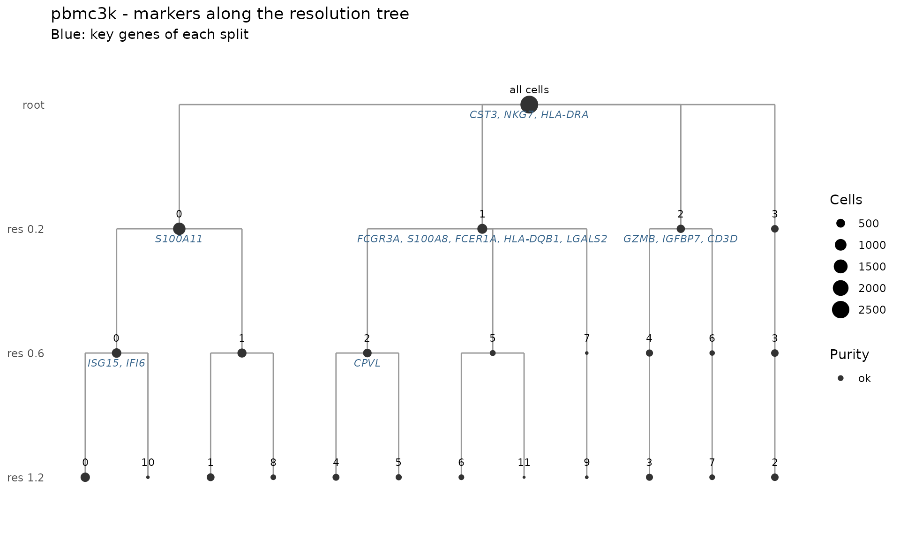

``` r

hm$plots$dotplot
```

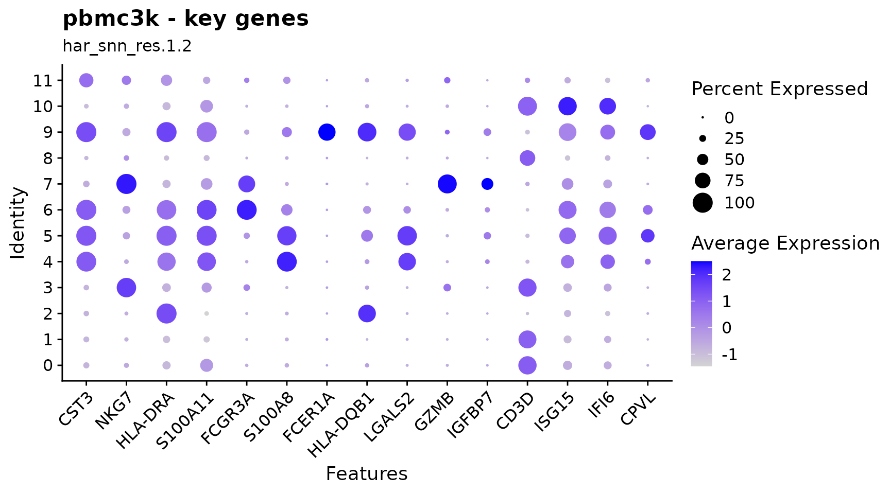

## 2. Comparing marker tables across conditions

When markers are computed separately for each condition, batch or
integration method, the question becomes how the marker profiles differ
between those runs. Two functions take such a combined table. It needs
the columns `gene`, `cluster`, `avg_log2FC`, `diff` (= `pct.1 - pct.2`)
and an identifier column.

Here we compute cluster markers separately for each of the six
severity-by-batch groups of the simulated cohort.

``` r

pbmc$group <- paste(pbmc$severity, pbmc$batch, sep = "_")

marker_tbl <- bind_rows(lapply(sort(unique(pbmc$group)), function(g) {
  sub <- subset(pbmc, subset = group == g)
  Idents(sub) <- "seurat_clusters"
  FindAllMarkers(sub, only.pos = TRUE, logfc.threshold = 0.25, min.pct = 0.1, verbose = FALSE) %>%
    mutate(diff = pct.1 - pct.2, group = g)
}))

marker_tbl %>% dplyr::count(group)
#>             group    n
#> 1 Healthy_Batch_1 3973
#> 2 Healthy_Batch_2 3153
#> 3    Mild_Batch_1 4285
#> 4    Mild_Batch_2 3701
#> 5  Severe_Batch_1 4694
#> 6  Severe_Batch_2 4220
```

### `plot_gene_markers_with_dendro()`

Averages the marker statistics per gene and group, clusters the groups
(Ward.D2) and draws a dot plot. Dot size shows log2FC and colour shows
the difference in detection rate. The clusters in which each gene was a
marker are written above the dots, and the dendrogram is attached beside
the plot. `genes` accepts a vector or a single regular expression.

``` r

gm <- plot_gene_markers_with_dendro(
  df         = marker_tbl,
  genes      = c("CD14", "LYZ", "S100A8", "S100A9", "FCGR3A", "MS4A7",
                 "GNLY", "NKG7", "MS4A1", "CD79A", "IL7R", "CCR7", "PPBP"),
  id_col     = "group",
  plot_title = "Canonical markers across cohort groups",
  output_dir = file.path(out_dir, "marker_dendro")
)
```

``` r

gm$combined
```

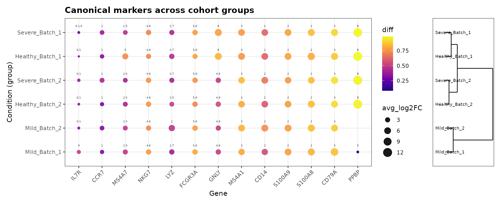

### `plot_split_dotplots_by_gene_cluster()`

For gene families with many members, this function plots every *gene x
cluster* combination. It splits the x-axis into `n_splits` dot plots and
saves a global dendrogram of the groups. Here we use a regular
expression to select all HLA class II genes.

``` r

plot_split_dotplots_by_gene_cluster(
  df                = marker_tbl,
  gene_regex        = "^HLA-D",
  id_col            = "group",
  n_splits          = 2,
  plot_title_prefix = "HLA class II markers",
  output_dir        = file.path(out_dir, "split_dot")
)
```

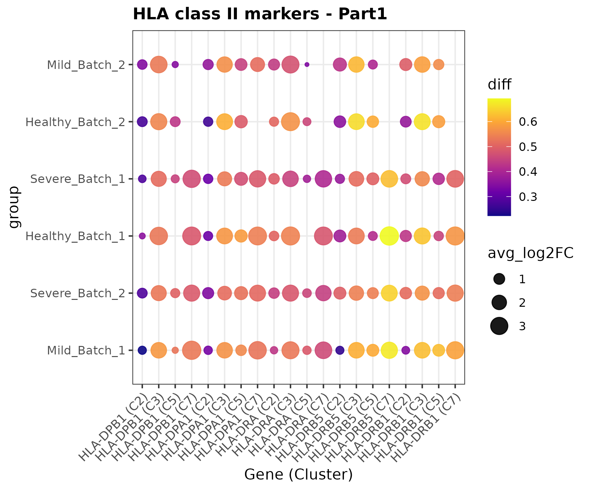

## 3. Pathway enrichment

Both enrichment pipelines take a marker table with one block of genes
per `cluster` and a two-column **TERM2GENE** table, here the MSigDB
Hallmark collection. If the table also has a column whose name contains
`cell_type`, results are additionally summarised per cell type. We
therefore compute markers for the nine `seurat_clusters` (two of which
are CD4 T) and attach their cell type.

``` r

hallmark <- load_hallmark_sets()     # MSigDB Hallmark gene sets; NULL if they cannot be downloaded
have_sets <- !is.null(hallmark)

Idents(pbmc) <- "seurat_clusters"
mk_clusters <- FindTopMarkersAndHeatmap(
  seurat_obj      = pbmc,
  sample_name     = "pbmc3k_clusters",
  onlyPos         = FALSE,             # GSEA needs both tails of the ranking
  output_dir_base = file.path(out_dir, "markers"),
  dpi             = 72
)

enrich_df <- mk_clusters$markers %>%
  mutate(cluster   = as.character(cluster),
         cell_type = as.character(pbmc$cell_type[match(cluster, pbmc$seurat_clusters)]))
```

``` r

dim(enrich_df)
#> [1] 19541     8
dplyr::as_tibble(dplyr::distinct(enrich_df, cluster, cell_type))
#> # A tibble: 9 × 2
#>   cluster cell_type  
#>   <chr>   <chr>      
#> 1 0       CD4 T      
#> 2 1       CD4 T      
#> 3 2       CD14 Mono  
#> 4 3       B          
#> 5 4       CD8 T      
#> 6 5       FCGR3A Mono
#> 7 6       NK         
#> 8 7       DC         
#> 9 8       Platelet
```

### Gene Set Enrichment Analysis: `run_global_gsea()`

For every cluster, genes are ranked by `avg_log2FC` and tested with
[`clusterProfiler::GSEA()`](https://rdrr.io/pkg/clusterProfiler/man/GSEA.html).
A first pass collects the NES range of all clusters, so every
per-cluster dot plot shares the same x-axis and can be compared
directly. The function saves per-cluster NES dot plots, a classic
enrichment plot for the top pathway of each cluster, alphabetical and
hierarchically clustered overview dot plots, signed-significance plots
(global and per cell type), and CSV summaries.

``` r

gsea_dir <- file.path(out_dir, "gsea")

gsea_res <- run_global_gsea(
  GSEA_df             = enrich_df,
  m_t2g               = hallmark,
  output_dir          = gsea_dir,
  title_prefix        = "Hallmark",
  top_n_per_direction = 8,
  top_n_overall       = 4
)
```

``` r

gsea_res %>%
  group_by(cluster) %>%
  slice_min(p.adjust, n = 2, with_ties = FALSE) %>%
  dplyr::select(cluster, cell_type, Description, NES, p.adjust) %>%
  arrange(as.numeric(cluster))
#> # A tibble: 15 × 5
#> # Groups:   cluster [8]
#>    cluster cell_type   Description                        NES     p.adjust
#>    <chr>   <chr>       <chr>                            <dbl>        <dbl>
#>  1 0       CD4 T       HALLMARK_COMPLEMENT              -1.62 0.0272      
#>  2 0       CD4 T       HALLMARK_ALLOGRAFT_REJECTION     -1.54 0.0272      
#>  3 1       CD4 T       HALLMARK_KRAS_SIGNALING_UP       -1.92 0.000143    
#>  4 1       CD4 T       HALLMARK_ALLOGRAFT_REJECTION     -1.70 0.000143    
#>  5 2       CD14 Mono   HALLMARK_ALLOGRAFT_REJECTION     -2.04 0.000397    
#>  6 2       CD14 Mono   HALLMARK_MYC_TARGETS_V1          -1.92 0.00261     
#>  7 3       B           HALLMARK_COMPLEMENT              -1.94 0.00388     
#>  8 3       B           HALLMARK_INFLAMMATORY_RESPONSE   -1.93 0.00388     
#>  9 4       CD8 T       HALLMARK_KRAS_SIGNALING_UP       -2.10 0.000487    
#> 10 5       FCGR3A Mono HALLMARK_ALLOGRAFT_REJECTION     -2.43 0.0000000790
#> 11 5       FCGR3A Mono HALLMARK_XENOBIOTIC_METABOLISM    1.71 0.0135      
#> 12 6       NK          HALLMARK_TNFA_SIGNALING_VIA_NFKB -2.29 0.000757    
#> 13 6       NK          HALLMARK_ALLOGRAFT_REJECTION     -1.74 0.0440      
#> 14 8       Platelet    HALLMARK_MYC_TARGETS_V1          -2.80 0.000194    
#> 15 8       Platelet    HALLMARK_COAGULATION              2.09 0.000194
```

The clustered overview groups clusters with similar pathway activity.
The two CD4 T clusters (0 and 1) are neighbours, while CD14 monocytes
(cluster 2) and platelets (cluster 8) stand apart. Cluster 2 has
activated inflammatory and TNF-alpha signalling, and cluster 8 has
activated coagulation. Clusters without significant pathways, here the
small DC cluster 7, are left out.

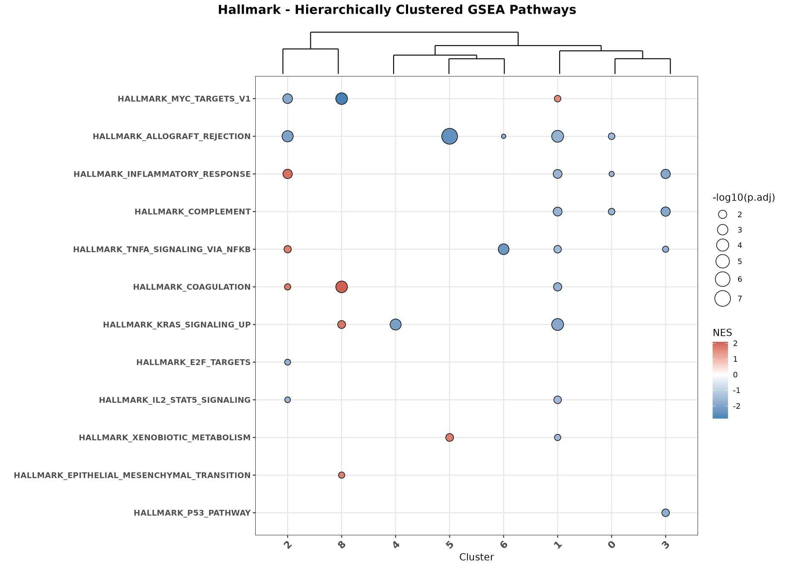

The signed-significance view puts direction and significance on one
axis:

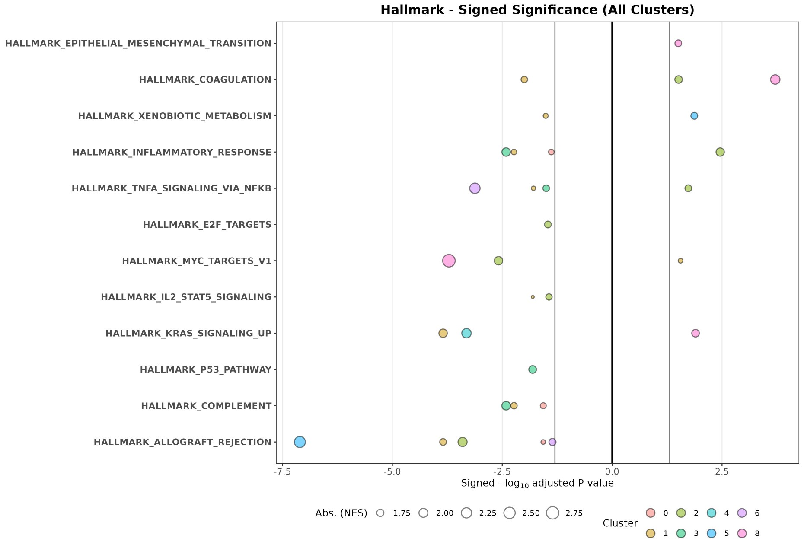

Per-cluster outputs for cluster 2 (CD14 monocytes): the NES dot plot and
the running enrichment score of its top pathway.

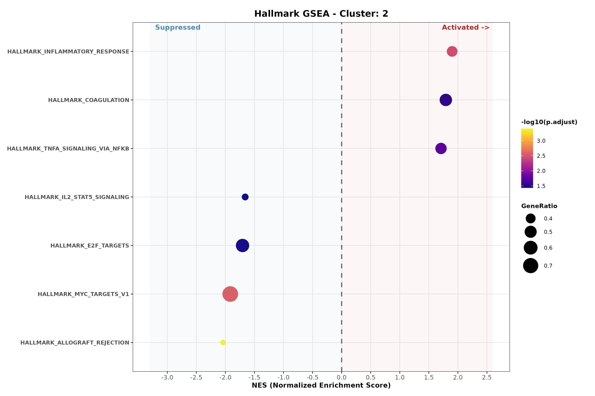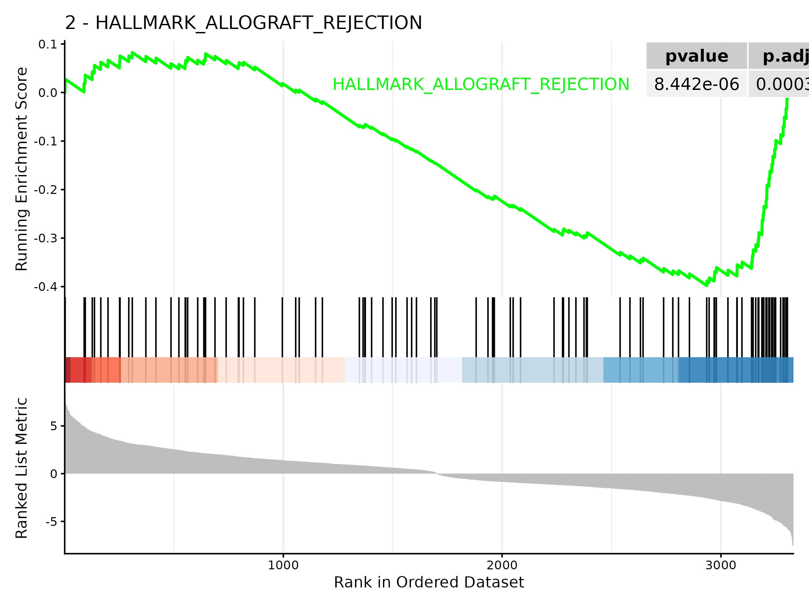

### Over-Representation Analysis: `run_global_ora()`

ORA splits each cluster’s genes into **Activated**
(`avg_log2FC > log2fc_cutoff`) and **Suppressed**
(`avg_log2FC < -log2fc_cutoff`) sets at `p_val_adj < padj_cutoff`, and
tests each set with
[`clusterProfiler::enricher()`](https://rdrr.io/pkg/clusterProfiler/man/enricher.html)
against the universe of all tested genes. With
`variable_per_clus = TRUE`, the function also draws a
signed-significance plot for every cell type.

``` r

ora_dir <- file.path(out_dir, "ora")

ora_res <- run_global_ora(
  ORA_df            = enrich_df,
  m_t2g             = hallmark,
  output_dir        = ora_dir,
  title_prefix      = "Hallmark",
  top_n_global      = 20,
  top_n_per_cluster = 8,
  log2fc_cutoff     = 0.25,
  padj_cutoff       = 0.05,
  global_width      = 11,
  global_height     = 8,
  variable_per_clus = TRUE
)
```

``` r

ora_res %>%
  dplyr::count(cluster, cell_type, Direction) %>%
  arrange(as.numeric(cluster))
#>    cluster   cell_type  Direction n
#> 1        0       CD4 T  Activated 4
#> 2        0       CD4 T Suppressed 4
#> 3        1       CD4 T  Activated 2
#> 4        1       CD4 T Suppressed 4
#> 5        2   CD14 Mono  Activated 7
#> 6        2   CD14 Mono Suppressed 2
#> 7        3           B  Activated 2
#> 8        3           B Suppressed 5
#> 9        4       CD8 T  Activated 2
#> 10       4       CD8 T Suppressed 3
#> 11       5 FCGR3A Mono  Activated 3
#> 12       5 FCGR3A Mono Suppressed 2
#> 13       6          NK  Activated 2
#> 14       6          NK Suppressed 2
#> 15       7          DC  Activated 1
#> 16       7          DC Suppressed 1
#> 17       8    Platelet  Activated 5
#> 18       8    Platelet Suppressed 1
```

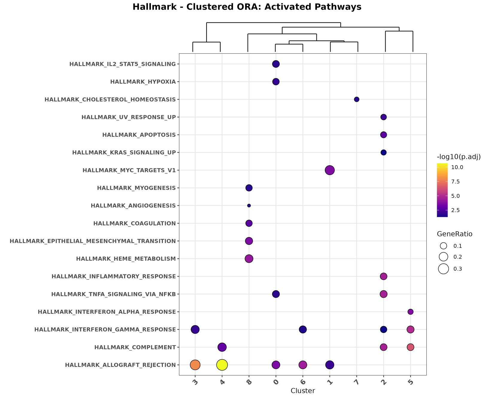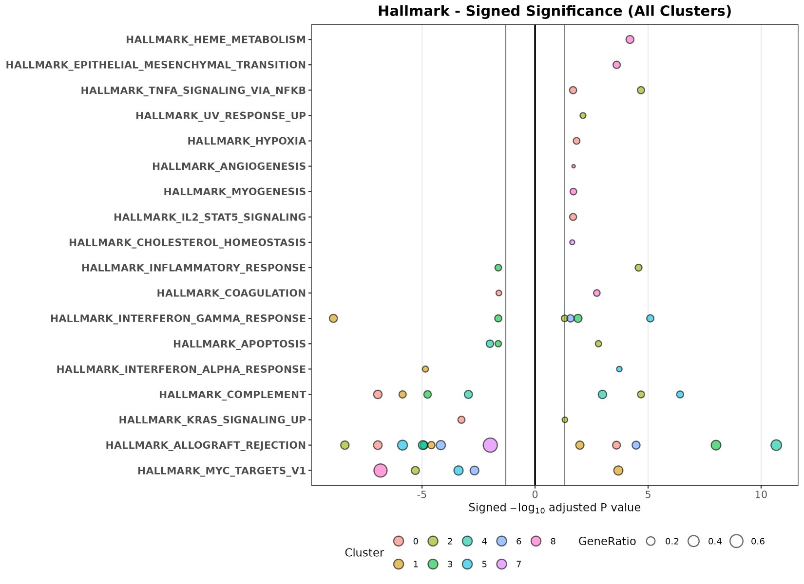

Per-cluster ORA outputs (cluster 2, CD14 monocytes):

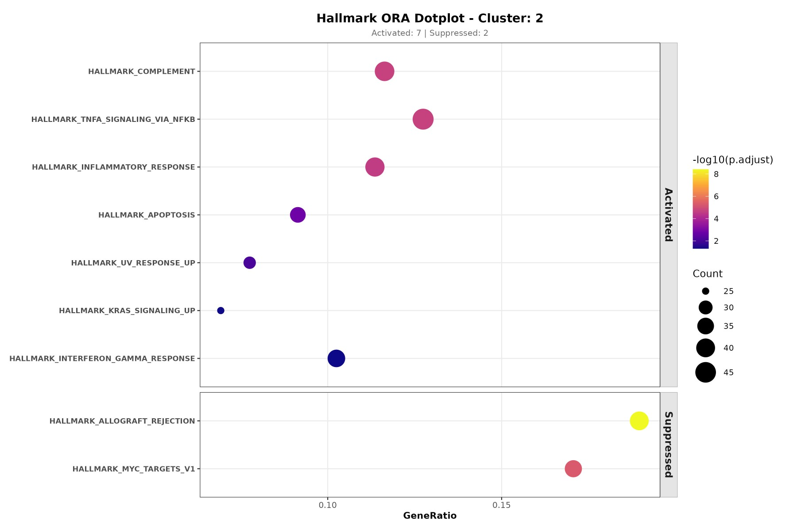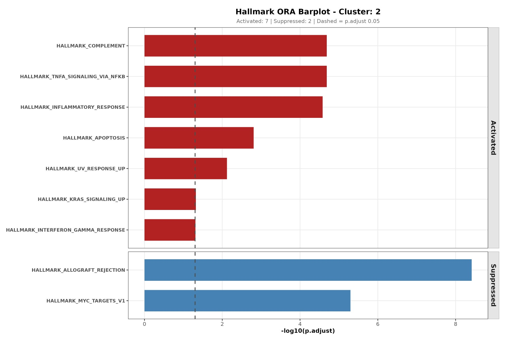

## 4. Pseudo-bulk differential expression with DESeq2

Cluster markers compare cells. A pseudo-bulk analysis compares
**samples**: the counts of each donor x population are summed and
analysed with DESeq2, which correctly models donor-to-donor variability.
Here we compare FCGR3A+ with CD14+ monocytes within the same donors,
using a paired design (`~ donor + subset`).

``` r

mono <- subset(pbmc, subset = cell_type %in% c("CD14 Mono", "FCGR3A Mono"))
mono$subset <- ifelse(mono$cell_type == "CD14 Mono", "CD14", "FCGR3A")

pb <- AggregateExpression(mono, assays = "RNA", group.by = c("donor_id", "subset"),
                          return.seurat = FALSE)$RNA
coldata <- data.frame(
  row.names = colnames(pb),
  donor     = sub("_.*$", "", colnames(pb)),
  subset    = factor(sub("^.*_", "", colnames(pb)), levels = c("CD14", "FCGR3A"))
)
coldata$severity <- pbmc$severity[match(coldata$donor, pbmc$donor_id)]

dds <- DESeqDataSetFromMatrix(round(pb), colData = coldata, design = ~ donor + subset)
dds <- dds[rowSums(counts(dds) >= 10) >= 3, ]
dds <- DESeq(dds, quiet = TRUE)

res_df <- as.data.frame(results(dds, contrast = c("subset", "FCGR3A", "CD14")))
head(res_df[order(res_df$padj), c("baseMean", "log2FoldChange", "padj")])
#>         baseMean log2FoldChange          padj
#> LYZ    706.46793      -2.704557 4.929477e-292
#> S100A9 457.18515      -3.398321 7.259356e-246
#> S100A8 234.80835      -4.126624  4.058690e-94
#> IFITM2 127.59239       2.092271  7.443002e-68
#> RPS19  415.98458       1.033596  5.524907e-59
#> FCGR3A  72.36845       4.791753  8.388277e-56
```

### Volcano trio: `generate_volcano_trio()`

The function expects a data frame with gene symbols as row names and the
DESeq2 columns `log2FoldChange` and `padj`. Seurat results can be used
after renaming `avg_log2FC` and `p_val_adj`. It returns three volcano
plots (made with EnhancedVolcano) that label, in turn, the top 10 up-
and down-regulated genes, the significant genes from your own
`target_genes` list, and both together. Genes are labelled only if they
pass `padj < 0.05` and `|log2FC| >= 1`.

``` r

volcano <- generate_volcano_trio(
  res          = res_df,
  main_title   = "FCGR3A+ vs CD14+ monocytes (pseudo-bulk, paired by donor)",
  target_genes = c("FCGR3A", "MS4A7", "CDKN1C", "LST1", "CSF1R",
                   "CD14", "LYZ", "S100A8", "VCAN", "CCR2")
)
volcano
```

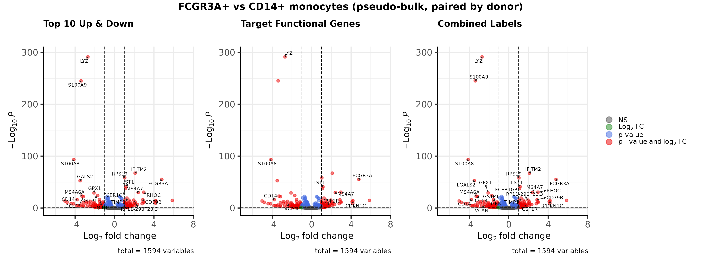

### Heatmap of the top genes: `get_top_mixed_genes()` and `generate_and_save_heatmap()`

[`get_top_mixed_genes()`](https://chomchonu.github.io/OHMmy/reference/get_top_mixed_genes.md)
returns the union of the `n_padj` most significant genes and the `n_lfc`
genes with the largest effect, chosen among the strictly significant
ones. This way neither highly significant small changes nor large
effects in lowly expressed genes are missed.

``` r

top_genes <- get_top_mixed_genes(res_df, n_padj = 25, n_lfc = 25)
length(top_genes)
#> [1] 39
head(top_genes, 15)
#>  [1] "LYZ"    "S100A9" "S100A8" "IFITM2" "RPS19"  "FCGR3A" "LGALS2" "LST1"  
#>  [9] "FCER1G" "RHOC"   "MS4A7"  "GPX1"   "GSTP1"  "MS4A6A" "CCL3"
```

[`generate_and_save_heatmap()`](https://chomchonu.github.io/OHMmy/reference/generate_and_save_heatmap.md)
uses these genes to draw two row-scaled heatmaps of the
variance-stabilised counts. The left heatmap keeps your sample order
(`ordered_samps`) and the right one clusters the samples freely.

``` r

vsd <- vst(dds, blind = FALSE)

anno_col <- as.data.frame(colData(vsd)[, c("subset", "severity")])
ordered_samples <- rownames(anno_col)[order(anno_col$subset, anno_col$severity)]

heatmap_dir <- file.path(out_dir, "deseq2")

generate_and_save_heatmap(
  res_obj       = res_df,
  comp_name     = "FCGR3A_vs_CD14",
  comp_title    = "FCGR3A+ vs CD14+ monocytes",
  vsd_data      = vsd,
  anno_col      = anno_col,
  ordered_samps = ordered_samples,
  n_padj        = 25,
  n_lfc         = 25,
  out_dir       = heatmap_dir,
  ts            = format(Sys.time(), "%Y%m%d_%H%M%S"),
  clus          = "Monocytes"
)
```

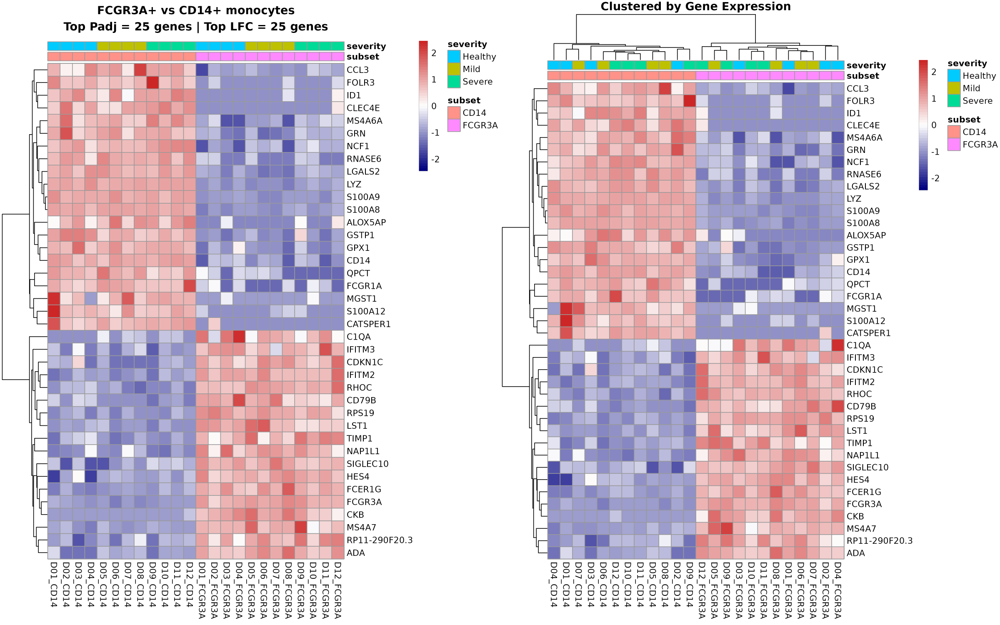

In the unordered (right) heatmap the samples split by monocyte subset,
not by the simulated severity. This is expected, because severity was
simulated and has no transcriptional effect.

## Session information

``` r

sessionInfo()
#> R version 4.6.2 (2026-10-29)
#> Platform: x86_64-pc-linux-gnu
#> Running under: Ubuntu 22.04.5 LTS
#> 
#> Matrix products: default
#> BLAS:   /usr/lib/x86_64-linux-gnu/openblas-pthread/libblas.so.3 
#> LAPACK: /usr/lib/x86_64-linux-gnu/openblas-pthread/libopenblasp-r0.3.20.so;  LAPACK version 3.10.0
#> 
#> locale:
#>  [1] LC_CTYPE=C.UTF-8       LC_NUMERIC=C           LC_TIME=C.UTF-8       
#>  [4] LC_COLLATE=C.UTF-8     LC_MONETARY=C.UTF-8    LC_MESSAGES=C.UTF-8   
#>  [7] LC_PAPER=C.UTF-8       LC_NAME=C              LC_ADDRESS=C          
#> [10] LC_TELEPHONE=C         LC_MEASUREMENT=C.UTF-8 LC_IDENTIFICATION=C   
#> 
#> time zone: UTC
#> tzcode source: system (glibc)
#> 
#> attached base packages:
#> [1] stats4    stats     graphics  grDevices utils     datasets  methods  
#> [8] base     
#> 
#> other attached packages:
#>  [1] future_1.82.0               DESeq2_1.52.0              
#>  [3] SummarizedExperiment_1.42.0 Biobase_2.72.0             
#>  [5] MatrixGenerics_1.24.0       matrixStats_1.5.0          
#>  [7] GenomicRanges_1.64.0        Seqinfo_1.2.0              
#>  [9] IRanges_2.46.0              S4Vectors_0.50.3           
#> [11] BiocGenerics_0.58.1         generics_0.1.4             
#> [13] msigdbr_26.1.1              ggplot2_4.0.3              
#> [15] dplyr_1.2.1                 OHMmy_1.0.2.9000           
#> [17] Seurat_6.0.0                SeuratObject_5.4.0         
#> [19] sp_2.2-4                   
#> 
#> loaded via a namespace (and not attached):
#>   [1] RcppAnnoy_0.0.23        splines_4.6.2           ggplotify_0.1.4        
#>   [4] tibble_3.3.1            polyclip_1.10-7         enrichit_0.2.7         
#>   [7] rpart_4.1.27            fastDummies_1.7.6       lifecycle_1.0.5        
#>  [10] httr2_1.3.0             rstatix_1.1.0           globals_0.20.0         
#>  [13] processx_3.9.0          lattice_0.23-1          MASS_7.3-66            
#>  [16] backports_1.5.1         magrittr_2.0.5          sass_0.4.10            
#>  [19] rmarkdown_2.32          jquerylib_0.1.4         yaml_2.3.12            
#>  [22] ggtangle_0.1.5          otel_0.3.0              sctransform_0.4.3      
#>  [25] spam_2.11-4             EnhancedVolcano_1.30.0  cowplot_1.2.0          
#>  [28] pbapply_1.7-5           DBI_1.3.0               RColorBrewer_1.1-3     
#>  [31] abind_1.4-8             Rtsne_0.17              purrr_1.2.2            
#>  [34] ggraph_2.2.2            yulab.utils_0.2.5       tweenr_2.0.3           
#>  [37] rappdirs_0.3.4          aisdk_1.4.12            gdtools_0.5.3          
#>  [40] enrichplot_1.32.1       ggrepel_0.9.8           irlba_2.4.1            
#>  [43] listenv_1.1.0           tidytree_0.4.8          pheatmap_1.0.13        
#>  [46] RSpectra_0.16-2         parallelly_1.50.0       pkgdown_2.2.1          
#>  [49] codetools_0.2-20        DelayedArray_0.38.2     DOSE_4.6.0             
#>  [52] ggforce_0.5.0           tidyselect_1.2.1        aplot_0.3.2            
#>  [55] farver_2.1.2            SoupX_1.6.2             viridis_0.6.5          
#>  [58] jsonlite_2.0.0          tidygraph_1.3.1         progressr_1.1.0        
#>  [61] Formula_1.2-6           ggridges_0.5.7          systemfonts_1.3.2      
#>  [64] ggnewscale_0.5.2        tools_4.6.2             treeio_1.36.1          
#>  [67] ragg_1.5.2              ica_1.0-3               Rcpp_1.1.2             
#>  [70] glue_1.8.1              gridExtra_2.3.1         SparseArray_1.12.3     
#>  [73] xfun_0.62               qvalue_2.44.0           withr_3.0.3            
#>  [76] fastmap_1.2.0           callr_3.8.0             digest_0.6.39          
#>  [79] gridGraphics_0.5-1      R6_2.6.1                textshaping_1.0.5      
#>  [82] scattermore_1.2         GO.db_3.23.1            jpeg_0.1-11            
#>  [85] RSQLite_3.53.3          utf8_1.2.6              tidyr_1.3.2            
#>  [88] fontLiberation_0.1.0    pls_2.9-0               graphlayouts_1.2.5     
#>  [91] httr_1.4.9              htmlwidgets_1.6.4       S4Arrays_1.12.1        
#>  [94] scatterpie_0.2.6        uwot_0.2.5              pkgconfig_2.0.3        
#>  [97] gtable_0.3.6            blob_1.3.0              S7_0.2.2               
#> [100] XVector_0.52.0          clusterProfiler_4.20.3  htmltools_0.5.9        
#> [103] fontBitstreamVera_0.1.1 carData_3.0-6           dotCall64_1.2          
#> [106] scales_1.4.0            png_0.1-9               ggfun_0.2.2            
#> [109] ggdendro_0.2.0          knitr_1.52              reshape2_1.4.5         
#> [112] nlme_3.1-171            cachem_1.1.0            stringr_1.6.0          
#> [115] KernSmooth_2.23-27      parallel_4.6.2          AnnotationDbi_1.74.0   
#> [118] desc_1.4.3              pillar_1.11.1           grid_4.6.2             
#> [121] vctrs_0.7.3             RANN_2.6.3              ggpubr_1.0.0           
#> [124] tidydr_0.0.7            car_3.1-5               cluster_2.1.8.3        
#> [127] evaluate_1.0.5          cli_3.6.6               locfit_1.5-9.12        
#> [130] compiler_4.6.2          rlang_1.3.0             crayon_1.5.3           
#> [133] leidenbase_0.1.37       future.apply_1.21.0     ggsignif_0.6.4         
#> [136] labeling_0.4.3          ps_1.9.3                plyr_1.8.9             
#> [139] fs_2.1.0                ggiraph_0.9.6           stringi_1.8.9          
#> [142] viridisLite_0.4.3       BiocParallel_1.46.0     assertthat_0.2.1       
#> [145] Biostrings_2.80.2       lazyeval_0.2.3          fontquiver_0.2.1       
#> [148] GOSemSim_2.38.3         Matrix_1.7-6            RcppHNSW_0.7.0         
#> [151] patchwork_1.3.2         bit64_4.8.6             KEGGREST_1.52.2        
#> [154] igraph_2.3.4            broom_1.0.13            memoise_2.0.1          
#> [157] bslib_0.12.0            ggtree_4.2.1            bit_4.6.0              
#> [160] gson_0.2.2              ape_5.8-1
```
